

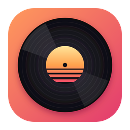

# MySpotify

**Spotify, in a real desktop app**

A native interface, lyrics that scroll, music videos and video podcasts. Free accounts play whole songs, and you can look around before signing in.

[简体中文](README.md) · **English**

   

**[Download the latest release](https://github.com/margbug01/MySpotify/releases/latest)** · [Website](https://margbug01.github.io/MySpotify/en.html) · [Install](#get-started) · [FAQ](#faq)

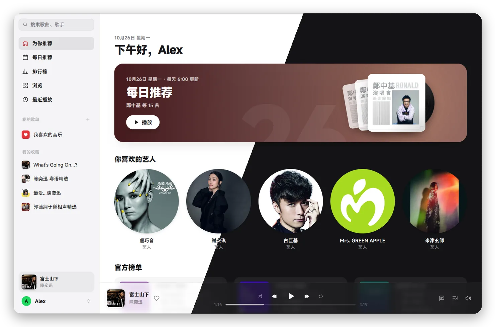

> [!IMPORTANT]
> MySpotify is a personal project. It has no connection to Spotify and isn't endorsed by it. It uses the internal interfaces of Spotify's web player rather than a public API, and Spotify can change them at any time. Using Spotify this way likely goes against its terms of use and could get your account restricted. Use only your own account, at your own risk. See [Risks and limits](#risks-and-limits).

> [!NOTE]
> The app's interface is in Chinese for now; this page and the website are in both languages.

## Why use it

| | |
| --- | --- |
| **Feels like desktop software** | The interface is drawn natively by [MyGo](https://github.com/egoist/mygo), not a web page in a frame: a sidebar, player bar, full-screen Now Playing, a rhythm stage, system media keys, global shortcuts, light and dark themes. Closing the window keeps the music going from the tray. About 190 MB in use while browsing, plus a decryption process of about 60 MB while playing. |
| **Look around without signing in** | Search, the home page, playlists, albums and artists are there the moment it opens: like the web player, MySpotify gets itself a guest identity, with content a second or two after a cold start. Sign in when you want to listen. |
| **Whole songs on a free account** | You sign in on Spotify's own page. The DRM module built into your system's web component decrypts the audio, the same path as listening in a browser, at 128k AAC: WebView2's Widevine on Windows, WebKit's FairPlay on macOS. |
| **Lyrics for nearly everything, and they scroll** | What Spotify lacks comes from NetEase Cloud Music and LRCLIB. Timed lyrics win, and the title and length must match, so another version never slips in. Foreign-language songs show a line of Chinese translation under each line when one exists. |
| **Music videos, too** | Songs with a video wear a small "MV" tag: click it to play, or switch from the player bar and Now Playing at any time. Watch in place of the cover, filling the window or full screen, with the current lyric below. If the lyrics are off, `[` / `]` shift them 0.5 s at a time, remembered per song. |
| **Podcasts to hear, watch and read along** | Video podcasts show their picture with one click. The transcript scrolls like lyrics, lighting up word by word, and clicking a sentence jumps to it. |
| **Most of what Spotify has is here** | Home, daily mixes, charts, all categories, playlists and albums, artist and song pages, your profile, search, likes, follows, saves, editing your own playlists, play next and the queue, radio, recently played. Playlists added on the web or your phone sync over by themselves. |
| **Hand off between phone and computer (experimental)** | Your computer appears in the device list of Spotify on your phone: tap it and the music moves over. While the phone plays, the computer can see it and control it. [Details](#hand-off-between-phone-and-computer-experimental) |
| **Errors don't leave it stuck** | An expired license gets a new identity and a retry. When rate limited, it waits as long as Spotify asks and resumes where it was. When the network drops, it picks up once the network is back. When an update to the web player retires an old query, MySpotify finds the new one in the live scripts by itself. |
| **No downloading a song twice** | Songs you've played stay on your computer as the encrypted segments they arrived in, so they start faster and use no data. Choose the limit in settings, or clear them all. |
| **Your data stays on your computer** | No analytics or tracking. It connects only to Spotify, Gravatar (for your account email's avatar), NetEase and LRCLIB for lyrics (they receive just the title, artist, album and length), and GitHub to check for updates. [Where data is kept](#where-are-settings-and-the-sign-in-kept) |

## Screenshots

<table>
  <tr>
    <td width="50%">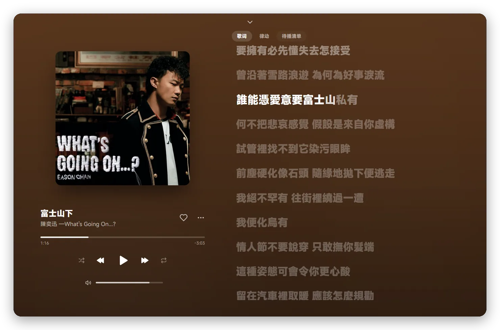</td>
    <td width="50%">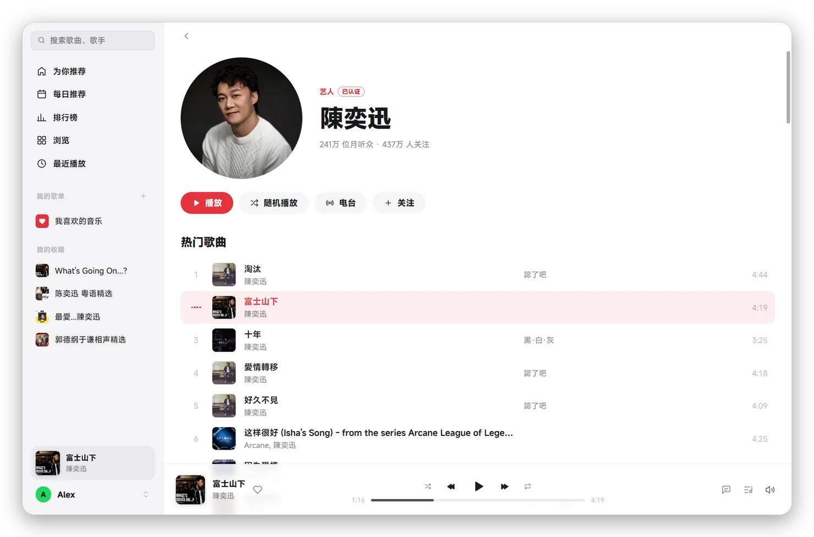</td>
  </tr>
  <tr>
    <td>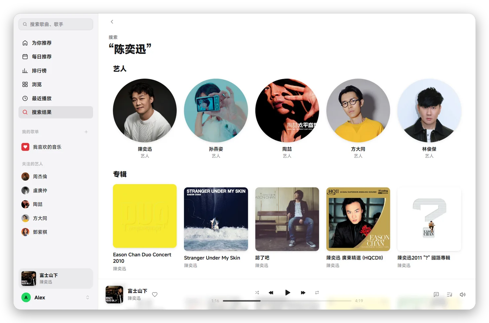</td>
    <td>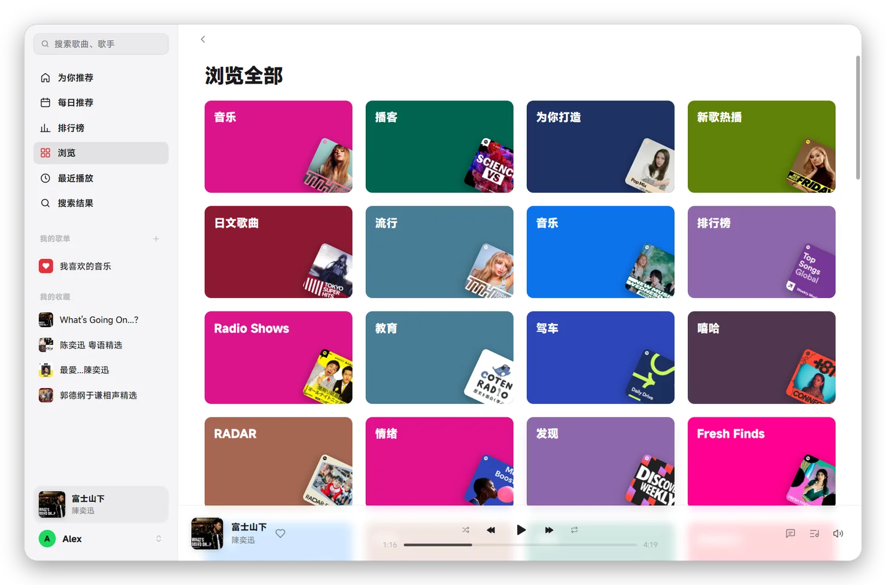</td>
  </tr>
  <tr>
    <td>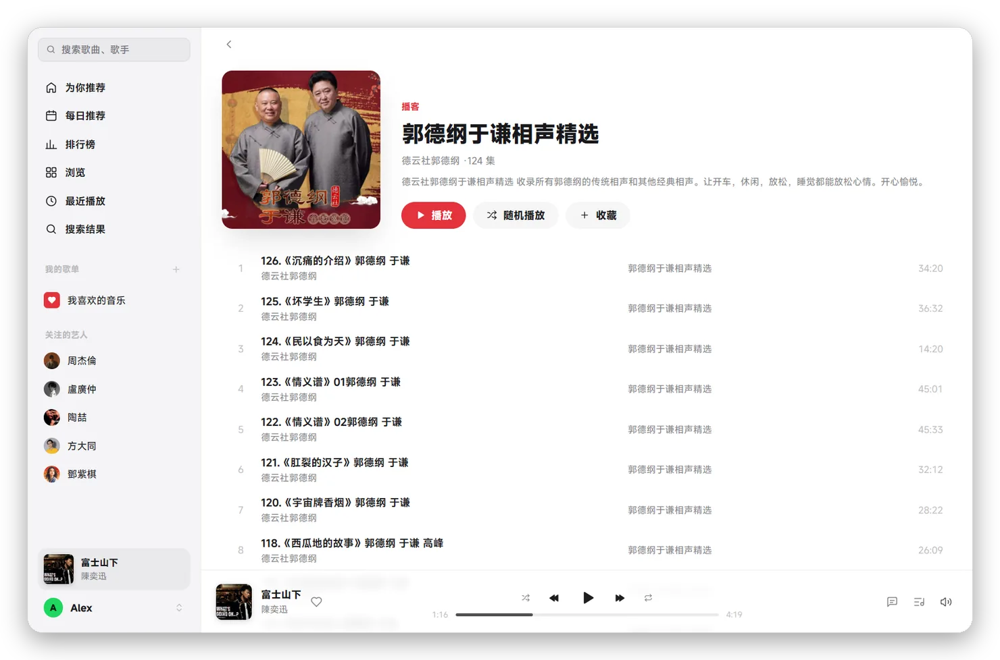</td>
    <td>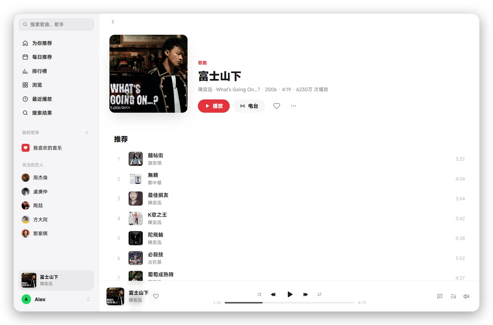</td>
  </tr>
</table>

More screenshots

<table>
  <tr>
    <td width="50%">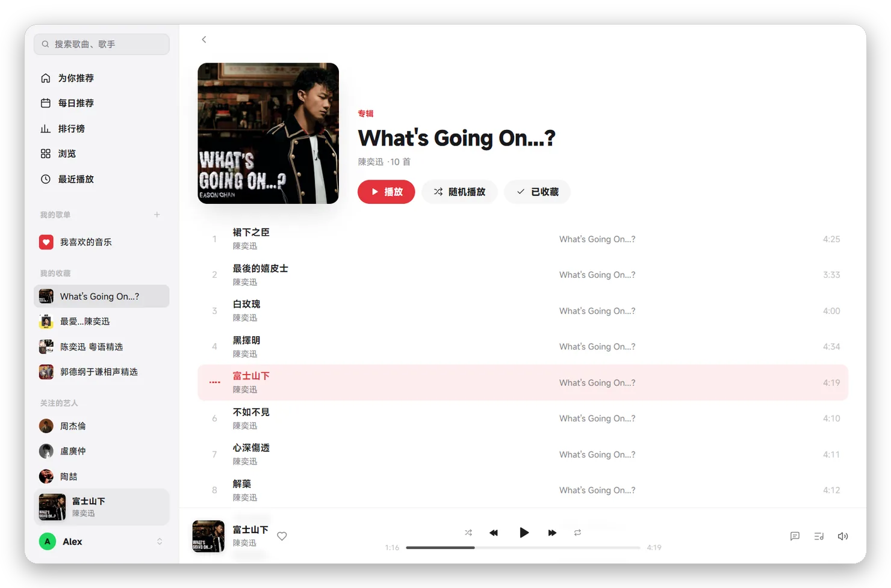</td>
    <td width="50%">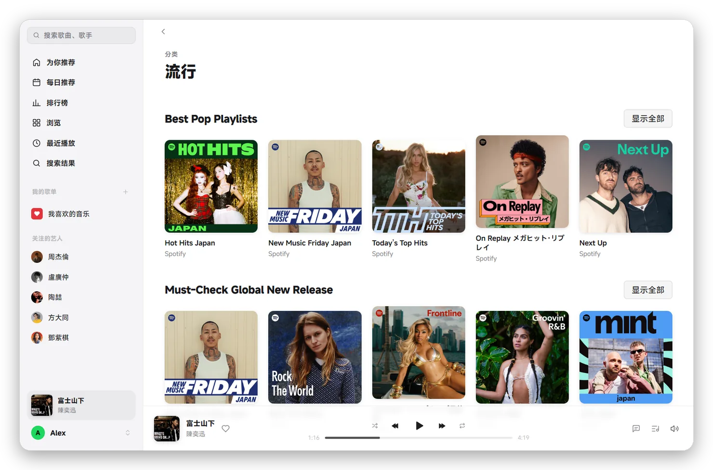</td>
  </tr>
  <tr>
    <td>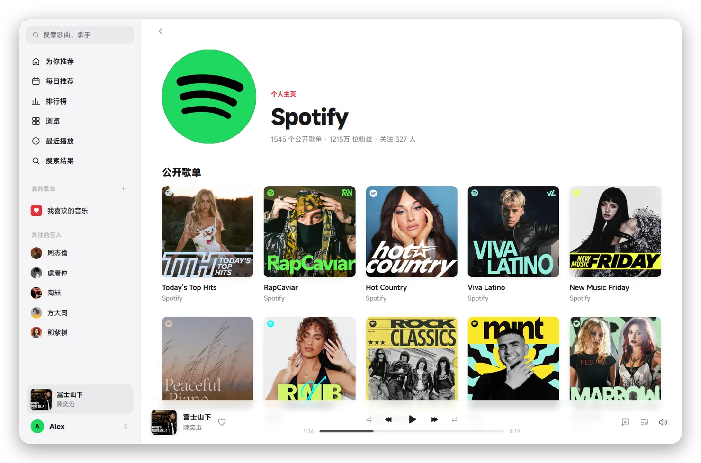</td>
    <td></td>
  </tr>
</table>

## Get started

### Windows

1. Download `MySpotify-<version>-windows-amd64.zip` from [Releases](https://github.com/margbug01/MySpotify/releases/latest), unzip it anywhere and double-click `MySpotify.exe`.
2. The exe isn't code-signed, so "Windows protected your PC" may appear the first time: click More info › Run anyway. If you'd rather check, compare the sha256 in the release, or [build it yourself](DEVELOPMENT.en.md#build-from-source).
3. It needs Windows 10 or 11 and the [WebView2 runtime](https://developer.microsoft.com/microsoft-edge/webview2/) (included in Windows 11, and already on most Windows 10 machines).

Updating: from 0.4.0 on, click 更新并重启 (Update and restart) under 设置 › 关于 (Settings › About); the bottom left of the sidebar tells you when there's a new version. Coming from 0.3.0 or earlier takes one manual update: right-click the tray icon, quit MySpotify, overwrite the old files with the new ones and open it again. Settings and your sign-in aren't kept beside the exe, so nothing is lost.

### macOS (Apple silicon)

1. Download `MySpotify-<version>-macos-arm64.dmg`, open it and drag MySpotify to Applications.
2. The app isn't notarized by Apple, so the first launch is blocked: go to System Settings › Privacy & Security and click Open Anyway at the bottom. Or run `xattr -dr com.apple.quarantine /Applications/MySpotify.app` in Terminal and open it.

Updating: from 0.4.0 on, click 更新并重启 (Update and restart) under 设置 › 关于 (Settings › About), or use the MySpotify menu's 检查更新… (Check for Updates). The app must be somewhere writable such as Applications; one opened from inside the dmg can't update itself. Coming from 0.3.0 takes one manual update: quit the old version and overwrite it in Applications with the new one. Settings and your sign-in aren't kept in the app, so nothing is lost.

### Sign in

On both: click 登录 Spotify (Sign in) and sign in on the Spotify page that opens. The sign-in stays on your computer, so you won't need to do it again next time.

### Shortcuts

| Action | Keys (⌘ instead of Ctrl on macOS) |
| --- | --- |
| Play / pause | `Space` |
| Previous / next | `Ctrl+←` / `Ctrl+→` |
| Like the song playing | `Ctrl+D` |
| Open Now Playing | `Ctrl+L` |
| Search | `Ctrl+F` |
| New playlist | `Ctrl+N` |
| Settings | `Ctrl+,` |
| Forward / back | Mouse side buttons |
| Video: full screen / step back out | `F` / `Esc` |
| Video: lyrics 0.5 s earlier / later | `[` / `]` |

Under 设置 › 全局快捷键 (Settings › Global shortcuts) you can also give play/pause, next and previous a key combination each that works from any app.

## Hand off between phone and computer (experimental)

- **Move playback to the computer**: choose "MySpotify · your computer's name" in the device list of Spotify on your phone or the web. The computer's queue is the same one the phone shows, and clicking a song in it jumps there in the original playlist (Spotify occasionally refuses this, see below).
- **Control the phone from the computer**: 设备 (Devices), beside the volume at the bottom, lists the phones, web players and this computer online on your account. While another device plays, the computer shows its song and progress, and play/pause, previous/next, seeking, volume, shuffle and repeat all go to that device.
- Only one device makes sound at a time. If playback moves away or the connection drops, the computer stops, so the two never play together.

This part is still experimental. Registering and handing off work in testing on a free account; staying connected for a long time and every combination of devices haven't been fully tested. Now and then it may say Spotify didn't accept an action. Spotify's reason goes into the log, `vinyl.log` (search for `connect:`), and that line is welcome in an issue.

## Risks and limits

- **It isn't an official client.** Data comes through the web player's Pathfinder GraphQL and spclient interfaces, none of them publicly documented. When Spotify changes them, MySpotify breaks.
- **The guest identity.** When you aren't signed in, MySpotify gets an anonymous identity the same way the web player does, and sees only what Spotify shows everyone. Listening still needs your own account.
- **The terms.** Spotify's terms of use don't allow third-party programs to access its service. Using MySpotify could get your account restricted or banned. Use only your own account, and nothing commercial.
- **Ads.** The web player's free tier plays ads; MySpotify doesn't. Spotify likely won't like that. If you mind, use the official client or subscribe to Premium.
- **It doesn't touch the keys.** MySpotify doesn't crack DRM: decryption happens inside WebView2's Widevine or WebKit's FairPlay module, and the program gets neither the keys nor the decrypted audio and video (which is why a music video is black in screenshots and recordings on macOS). It reads only the encryption scheme and key ID stated in the file header, to explain in the log why a song won't play. The cache holds the encrypted segments the CDN sent, and every play still asks Spotify for a license, so it can't work offline.
- **Where lyrics come from.** The NetEase interface used to fill in lyrics isn't publicly documented, rate limits frequent searches and could change any day. It and LRCLIB receive only the title, artist, album and length.
- **Don't start songs too often.** The license interface is rate limited per device. Starting playback repeatedly in a short time (say, a dozen times in half an hour) gets you a 429 for a while.

## What it can't do

| Feature | Why |
| --- | --- |
| 256k / lossless audio | A free account's license request for 256k is refused (403); lossless is only in the official desktop and phone apps |
| Word-by-word lyrics | Spotify gives the web player timing per line only; NetEase's word-by-word lyrics aren't hooked up yet |
| Offline downloads | Needs Premium and the official client |
| Jam, DJ | Needs Premium or the phone app |
| Some podcasts on macOS | Shows hosted by Spotify with Widevine-encrypted audio only can't be decrypted by FairPlay; video podcasts and shows with an original audio address all play |
| Chinese translation of podcast transcripts | Transcripts come only in the original language and a few foreign translations from Spotify, without Chinese |
| Spectrum | The audio is inside the decryption module, out of reach; the little bars during playback are an animation worked out from the position |
| Intel Macs, Linux | Installers are for Windows and Apple silicon Macs for now |
| Exact alignment of videos and lyrics | Spotify doesn't say how far a video and the original are apart, so it's estimated from their lengths; adjust with `[` / `]` when it's off |
| Friend activity, local files, Blend | Not built yet |

## FAQ

Why does a song say it can't be played right now?

It isn't available in your region, or Spotify refused the license (403). If the web player can't play it either, it's a licensing matter. The log `vinyl.log` (`%APPDATA%\Vinyl` on Windows, `~/Library/Application Support/Vinyl` on macOS) gives the exact reason.

The player bar says Spotify is rate limiting. What do I do?

Nothing. MySpotify waits as long as Spotify asks, then resumes where it was. The limit applies to MySpotify as a device, so the web player in your browser isn't affected.

Why are there no lyrics for this song, or why don't they scroll?

Spotify, NetEase and LRCLIB all lack them, or have only plain text without timing (shown still, with no scrolling or clicking a line to seek). Covers and live versions are used only when the length matches: better none than another version's. When a lyrics site is busy it asks again after 3 and 10 seconds, showing gray loading bars meanwhile.

Why is the daily mix page empty?

A new account has to listen for a while before Spotify makes a Daily Mix. Until then this page has nothing on it.

If songs are cached, why does it still need the network?

The cache holds encrypted audio, and decrypting it needs a license Spotify issues on the spot. The cache saves data and buffering.

How do I set a proxy?

It follows the system proxy by default: Settings › Network & Internet › Proxy on Windows, System Settings › Network › Details › Proxies on macOS, with the `HTTPS_PROXY` environment variable taking priority. You can also enter `127.0.0.1:7890`, `http://…`, `https://…` or `socks5://…` under Settings › Network › Proxy in MySpotify.

Why is a music video black in screenshots and recordings on macOS?

Videos are encrypted with FairPlay, and macOS doesn't give any screenshot or recording software the picture of encrypted video, just as with Apple TV+ in Safari. The interface and lyrics capture as usual.

How do I sign out or switch accounts?

Click your avatar at the bottom left and sign out. That clears Spotify's sign-in from the WebView.

Why does music keep playing after I close the window, and how do I quit?

Closing the window only sends it to the tray, and the music plays on. Click the tray icon or open MySpotify again to bring it back. To quit, right-click the tray icon and choose Quit MySpotify.

### Where are settings and the sign-in kept?

| What | Windows | macOS |
| --- | --- | --- |
| Settings, playback position, local history, log | `%APPDATA%\Vinyl` | `~/Library/Application Support/Vinyl` |
| Sign-in | `%LOCALAPPDATA%\Vinyl\WebView2` | `~/Library/WebKit/dev.margbug.vinyl` |
| Cookies for renewing the session (encrypted) | `%LOCALAPPDATA%\Vinyl\account-cookies` | `~/Library/Application Support/Vinyl/account-cookies` |

The cookies are encrypted: with DPAPI tied to the current user on Windows, with a key in the login keychain on macOS, so copying the file alone won't open it. They're deleted when you sign out or the sign-in expires. The folders are called Vinyl after the project's original name, left alone in the rename so nobody got signed out.

## Contributing

How it works, building from source, releases and debugging are all in the **[development guide](DEVELOPMENT.en.md)**.

## Acknowledgments

- The interface comes from [egoist/mygo-cloudmusic](https://github.com/egoist/mygo-cloudmusic), a NetEase Cloud Music client, with the data and playback replaced by Spotify's. The repository keeps the upstream history, so `git merge upstream/main` brings in the author's interface updates.
- [MyGo](https://github.com/egoist/mygo): a native UI framework for Go.
- [hls.js](https://github.com/video-dev/hls.js) (Apache-2.0), in `internal/player/web/hls.min.js`.
- [Flutify](https://github.com/is-hp-is-mad/Flutify): the reference for the structure of the Connect protocol.
- Lyrics from [LRCLIB](https://lrclib.net/) and NetEase Cloud Music.

## Links

- [LINUX DO](https://linux.do/): a sincere, friendly, united and professional community for quality open source and geeks

## More apps

MyGo apps by the same author: [Mami](https://github.com/margbug01/mami) · [MyShoes](https://github.com/margbug01/ShoesGUI) · [Candle](https://github.com/margbug01/Candle)

## License

[AGPL-3.0](LICENSE), following upstream. [`licenses/`](licenses) holds the licenses of the third-party code compiled into the program, shipped with it (beside the exe on Windows, in the app's Resources on macOS). The icon is MySpotify's own (`tools/icons.py`, "the turning record": a vinyl disc whose three grooves catch the light). Spotify is a trademark of Spotify AB; the name MySpotify only says what it plays, and covers and photos in the screenshots belong to their respective owners.
