<div align="center">

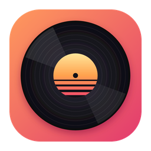

# MySpotify

**Spotify, in una vera app desktop**

Interfaccia nativa, testi che scorrono, video musicali e podcast video. Gli account gratuiti riproducono i brani per intero e puoi dare un'occhiata anche senza accedere.

[简体中文](README.md) · [English](README.en.md) · **Italiano**

[](https://github.com/margbug01/MySpotify/releases/latest)   

**[Scarica l'ultima versione](https://github.com/margbug01/MySpotify/releases/latest)** · [Sito](https://margbug01.github.io/MySpotify/en.html) · [Installazione](#per-iniziare) · [FAQ](#faq)

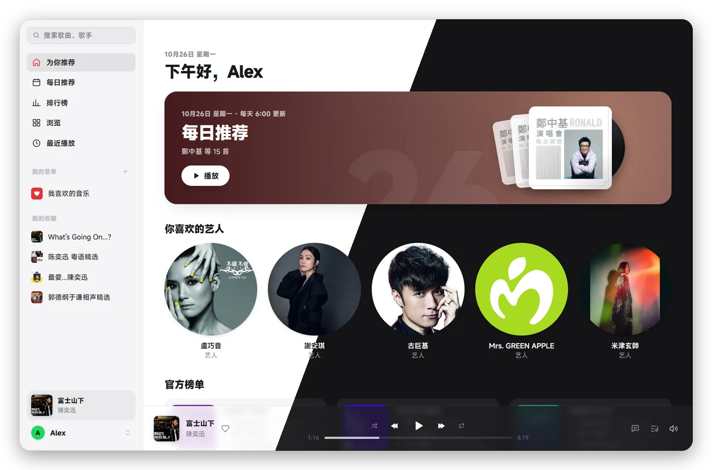

</div>

Sono disponibili build sperimentali per Linux (`.deb` / `.tar.gz`). Su amd64 il backend predefinito è Qt WebEngine, che usa un solo motore per accesso e riproduzione; migrazione di una sessione esistente, rinnovo dopo il riavvio e 75 secondi di musica reale sono stati verificati con WSLg, senza avviare Chrome. Servono un runtime Qt a parte e il componente Widevine del Chrome ufficiale. Linux non è ancora una piattaforma supportata in modo stabile. Vedi [installazione, misure di memoria e limiti](LINUX.md#qt-webengine-后端2026-11-10) (in cinese).

> [!IMPORTANT]
> MySpotify è un progetto personale. Non ha alcun legame con Spotify e non è approvato da Spotify. Usa le interfacce interne del web player di Spotify, non un'API pubblica, e Spotify può cambiarle in qualsiasi momento. Usare Spotify in questo modo molto probabilmente va contro i suoi termini d'uso e può far limitare il tuo account. Usa solo il tuo account, a tuo rischio. Vedi [Rischi e limiti](#rischi-e-limiti).

> [!NOTE]
> Dalla v0.4.17 l'interfaccia è disponibile in cinese semplificato e inglese, dalla v0.4.23 anche in italiano. In Impostazioni › Aspetto › Lingua scegli Sistema, 简体中文, English o Italiano; la scelta viene salvata e si applica subito. Titoli dei brani, nomi degli artisti e testi restano com'erano.

## Perché usarla

| | |
| --- | --- |
| **Sembra un programma desktop** | L'interfaccia è disegnata in modo nativo da [MyGo](https://github.com/egoist/mygo), non è una pagina web in una cornice: barra laterale, barra del player, schermata In riproduzione a tutto schermo, una scena a ritmo di musica, tasti multimediali del sistema, scorciatoie globali, temi chiaro e scuro. Chiudendo la finestra la musica continua dalla barra di sistema. Circa 190 MB in uso mentre navighi, più un processo di decifratura di circa 60 MB durante la riproduzione. |
| **Guarda senza accedere** | Ricerca, home, playlist, album e artisti sono lì appena apri l'app: come il web player, MySpotify si procura un'identità ospite, e i contenuti arrivano uno o due secondi dopo l'avvio a freddo. Accedi quando vuoi ascoltare. |
| **Brani interi con un account gratuito** | Accedi dalla pagina ufficiale di Spotify. L'audio è decifrato dal modulo DRM del componente web del sistema, lo stesso percorso di quando ascolti in un browser, a 128k AAC: Widevine di WebView2 su Windows, FairPlay di WebKit su macOS. |
| **Testi per quasi tutto, e scorrono** | Quello che manca a Spotify arriva da NetEase Cloud Music e LRCLIB. Hanno la precedenza i testi sincronizzati, e titolo e durata devono combaciare, così non finisce mai un'altra versione. Per i brani in lingua straniera, se esiste, sotto ogni riga c'è una riga di traduzione in cinese. Su Mac e Windows, Testo sul desktop nella barra del player fa fluttuare la riga cantata sopra tutte le finestre, con le parole che si illuminano del colore della copertina; bloccato, i clic lo attraversano. Dimensione, colore e cosa mostra la seconda riga (traduzione o riga successiva) si scelgono in Impostazioni › Testo sul desktop. |
| **Anche i video musicali** | I brani con un video hanno una piccola etichetta «MV»: clicca per riprodurlo, oppure passa al video in qualsiasi momento dalla barra del player e da In riproduzione. Lo guardi al posto della copertina, a finestra piena o a schermo intero, con il testo corrente sotto. Se il testo non è allineato, `[` / `]` lo spostano di 0,5 s alla volta, e lo scostamento viene ricordato per brano. |
| **Podcast da ascoltare, guardare e leggere** | I podcast video mostrano le immagini con un clic. La trascrizione scorre come un testo, si illumina parola per parola, e un clic su una frase porta lì. |
| **Quasi tutto quello che ha Spotify** | Home, mix giornalieri, classifiche, tutte le categorie, playlist e album, pagine di artisti e brani, il tuo profilo, ricerca, Mi piace, follow, salvataggi, modifica delle tue playlist, «riproduci come prossimo» e coda, radio, ascoltati di recente. Le playlist create sul web o sul telefono si sincronizzano da sole. |
| **Passaggio tra telefono e computer (sperimentale)** | Il tuo computer compare nell'elenco dispositivi di Spotify sul telefono: toccalo e la musica passa lì. Mentre il telefono riproduce, il computer lo vede e può controllarlo. [Dettagli](#passaggio-tra-telefono-e-computer-sperimentale) |
| **Gli errori non lo bloccano** | Una licenza scaduta ottiene una nuova identità e un nuovo tentativo. Con il limite di richieste attende il tempo chiesto da Spotify e riprende da dove era. Se cade la rete, riprende quando torna. Quando un aggiornamento del web player ritira una vecchia query, MySpotify trova da solo la nuova negli script online. |
| **Mai scaricare un brano due volte** | I brani già ascoltati restano sul computer nei segmenti cifrati in cui sono arrivati, quindi partono prima e non consumano dati. Il limite si sceglie nelle impostazioni, e si possono cancellare tutti. |
| **I tuoi dati restano sul tuo computer** | Nessuna analisi, nessun tracciamento. Si connette solo a Spotify, Gravatar (per l'avatar dell'email dell'account), NetEase e LRCLIB per i testi (ricevono solo titolo, artista, album e durata) e GitHub per cercare aggiornamenti. [Dove sono salvati i dati](#dove-sono-salvati-impostazioni-e-accesso) |

## Schermate

<table>
  <tr>
    <td width="50%">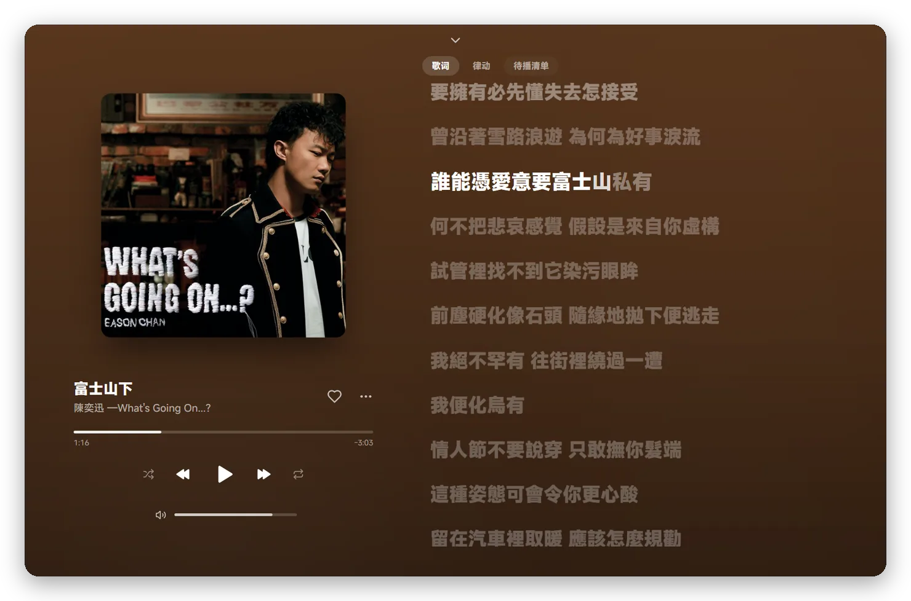</td>
    <td width="50%">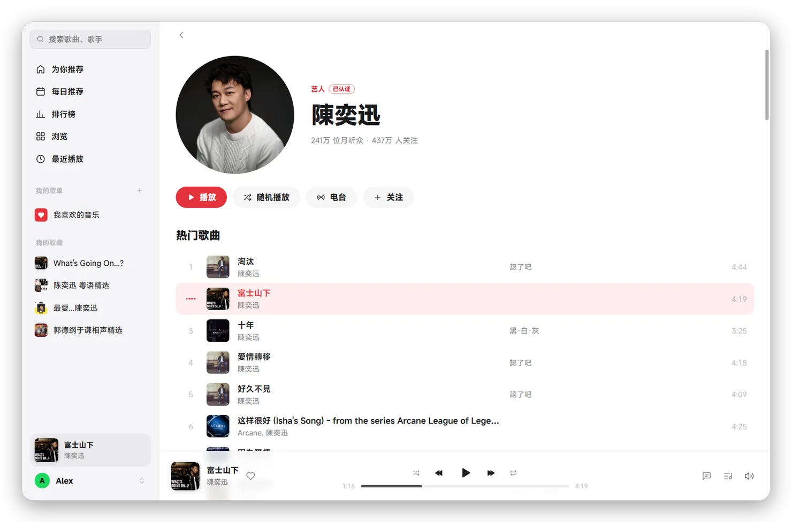</td>
  </tr>
  <tr>
    <td>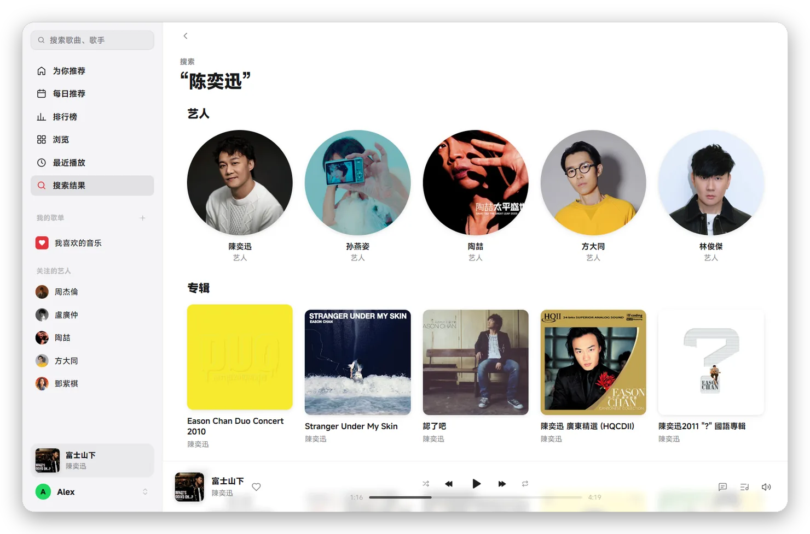</td>
    <td>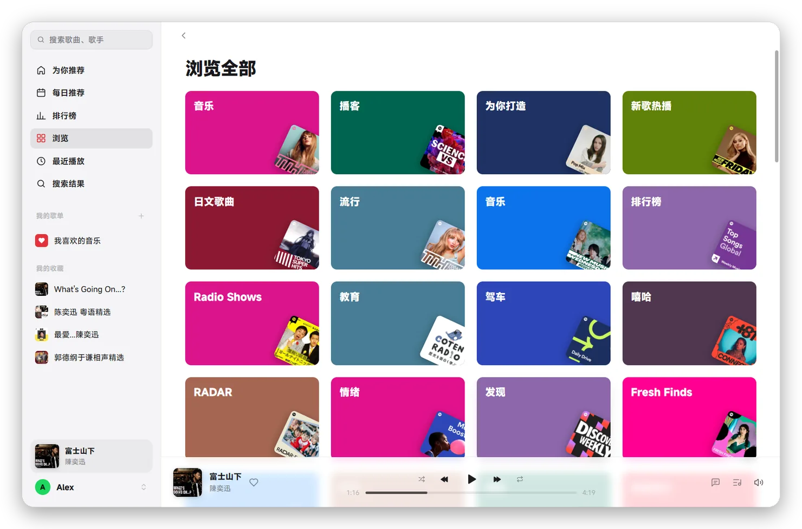</td>
  </tr>
  <tr>
    <td>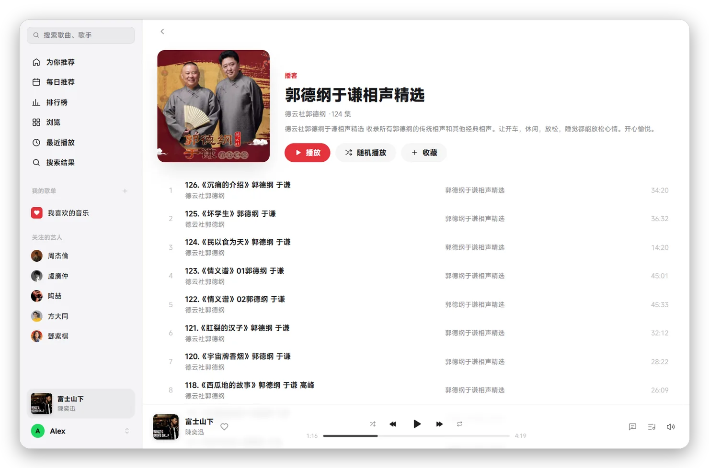</td>
    <td>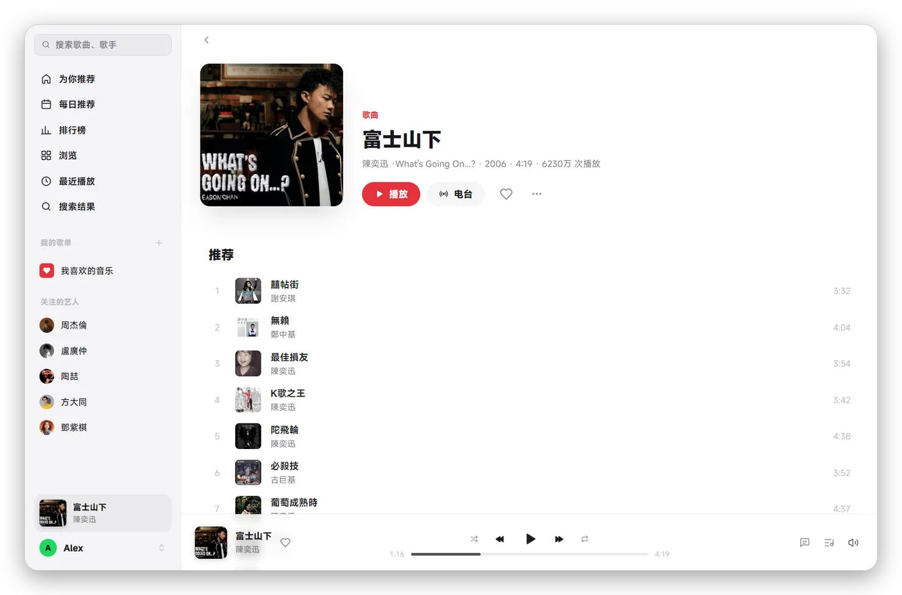</td>
  </tr>
</table>

<details>
<summary>Altre schermate</summary>

<table>
  <tr>
    <td width="50%">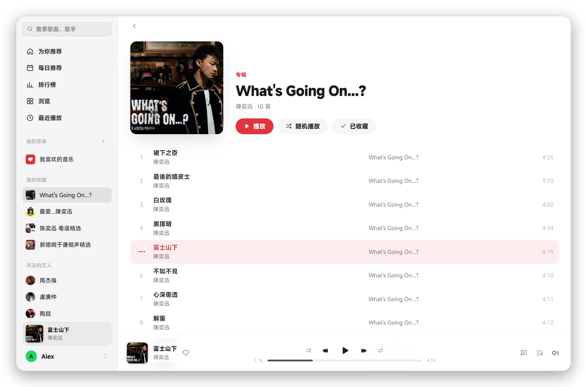</td>
    <td width="50%">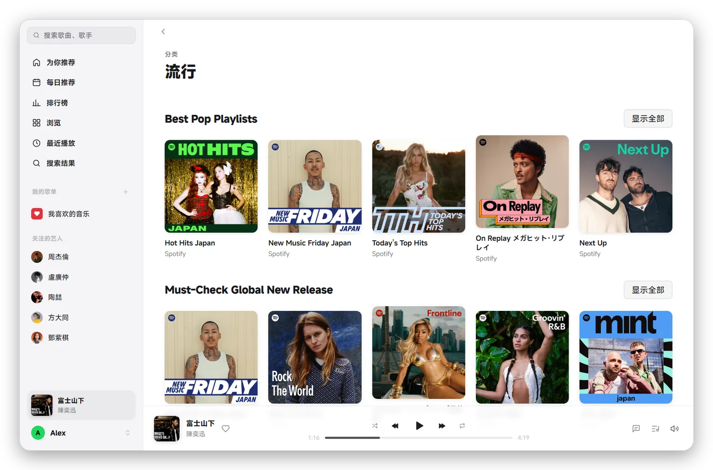</td>
  </tr>
  <tr>
    <td>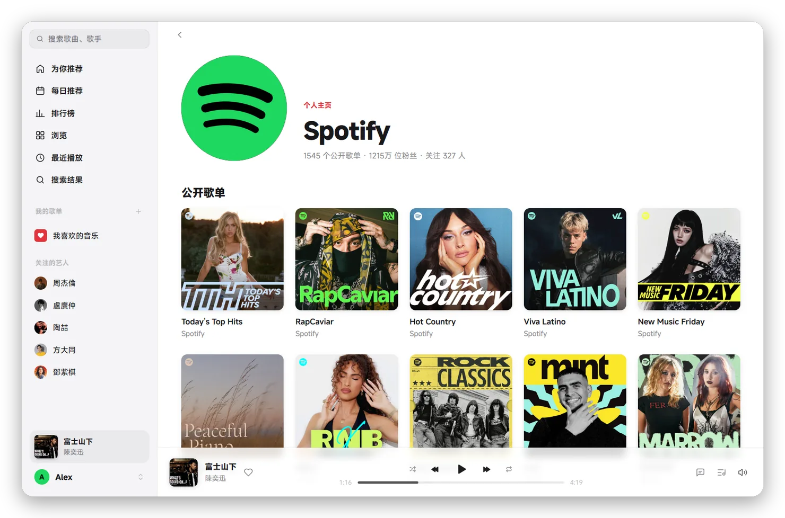</td>
    <td></td>
  </tr>
</table>

</details>

## Per iniziare

### Windows

1. Scarica `MySpotify-<versione>-windows-amd64.zip` da [Releases](https://github.com/margbug01/MySpotify/releases/latest), decomprimilo dove vuoi e fai doppio clic su `MySpotify.exe`.
2. L'exe non è firmato, quindi la prima volta può comparire «Windows ha protetto il PC»: clicca Ulteriori informazioni › Esegui comunque. Se preferisci verificare, confronta lo sha256 indicato nella release oppure [compilalo da solo](DEVELOPMENT.en.md#build-from-source).
3. Servono Windows 10 o 11 e il [runtime WebView2](https://developer.microsoft.com/microsoft-edge/webview2/) (incluso in Windows 11 e già presente nella maggior parte dei Windows 10).

Aggiornamento: dalla 0.4.0 clicca «Aggiorna e riavvia» in Impostazioni › Informazioni; in basso a sinistra nella barra laterale compare un avviso quando c'è una nuova versione. Da 0.3.0 o precedenti serve un aggiornamento manuale: clic destro sull'icona nella barra di sistema, esci da MySpotify, sovrascrivi i vecchi file con i nuovi e riaprilo. Impostazioni e accesso non stanno accanto all'exe, quindi non si perde nulla.

### macOS (Apple silicon / Intel)

1. Per Apple silicon scarica `MySpotify-<versione>-macos-arm64.dmg`; per Intel scarica `MySpotify-<versione>-macos-amd64.dmg` (sperimentale). Aprilo e trascina MySpotify in Applicazioni.
2. L'app non è notarizzata da Apple, quindi il primo avvio viene bloccato: vai in Impostazioni di Sistema › Privacy e sicurezza e clicca Apri comunque in fondo. Oppure esegui `xattr -dr com.apple.quarantine /Applications/MySpotify.app` nel Terminale e aprila.

La build Intel ha superato i controlli di cross-compilazione e del pacchetto. Accesso, riproduzione di musica / MV e aggiornamenti dall'app vanno ancora provati su un Mac Intel reale. Se qualcosa non va, indica modello del Mac, versione di macOS e log degli errori in [#15](https://github.com/margbug01/MySpotify/issues/15).

Aggiornamento: dalla 0.4.0 clicca «Aggiorna e riavvia» in Impostazioni › Informazioni, oppure usa «Controlla aggiornamenti…» nel menu MySpotify. L'app deve stare in un posto scrivibile, come Applicazioni; una aperta direttamente dal dmg non può aggiornarsi. Da 0.3.0 serve un aggiornamento manuale: esci dalla vecchia versione e sovrascrivila in Applicazioni con la nuova. Impostazioni e accesso non stanno nell'app, quindi non si perde nulla.

### Accesso

Su entrambi: clicca «Accedi a Spotify» e accedi nella pagina di Spotify che si apre. L'accesso resta sul tuo computer, quindi la prossima volta non dovrai rifarlo.

### Scorciatoie

| Azione | Tasti (⌘ al posto di Ctrl su macOS) |
| --- | --- |
| Riproduci / pausa | `Spazio` |
| Precedente / successivo | `Ctrl+←` / `Ctrl+→` |
| Mi piace al brano in riproduzione | `Ctrl+D` |
| Apri In riproduzione | `Ctrl+L` |
| Cerca | `Ctrl+F` |
| Nuova playlist | `Ctrl+N` |
| Impostazioni | `Ctrl+,` |
| Avanti / indietro | Pulsanti laterali del mouse |
| Video: schermo intero / un passo indietro | `F` / `Esc` |
| Video: testo 0,5 s in anticipo / in ritardo | `[` / `]` |

In Impostazioni › Scorciatoie globali puoi anche dare a riproduci/pausa, successivo e precedente una combinazione di tasti ciascuno, valida da qualsiasi app.

### Leggere cosa sta suonando con AppleScript (macOS)

Gli script possono leggere, non modificare, cosa sta suonando, un po' come con Music:

```applescript
tell application "MySpotify"
	set {state, pos, rate, t} to {player state, player position, player rate, current track}
end tell
if t is not missing value then return name of t & " - " & artist of t & " (" & kind of t & ")"
```

- `player state`: `playing` o `paused`, `stopped` finché non è caricato nulla
- `player position`: il punto in cui si trova, in secondi; `player rate`: la velocità di riproduzione, per un episodio quella scelta per i podcast, per un brano 1
- `current track`: un record con `id` (l'URI di Spotify, come `spotify:track:…`), `name`, `artist`, `album`, `duration` (secondi) e `kind` (`song` o `episode`). Finché non è caricato nulla vale `missing value`, come `player position`. Essendo un record e non un oggetto, un campo si ottiene con `name of (get current track)` oppure, come sopra, da una variabile

La prima volta che un'altra app (Editor di script, `osascript` nel Terminale) lo chiede, macOS domanda se consentirle di controllare MySpotify: consenti.

## Passaggio tra telefono e computer (sperimentale)

- **Spostare la riproduzione sul computer**: scegli «MySpotify · nome del tuo computer» nell'elenco dispositivi di Spotify sul telefono o sul web. La coda del computer è la stessa che mostra il telefono, e un clic su un brano della coda porta lì nella playlist originale (Spotify ogni tanto lo rifiuta, vedi sotto).
- **Controllare il telefono dal computer**: «Dispositivi», accanto al volume in basso, elenca telefoni, web player e questo computer online sul tuo account. Mentre un altro dispositivo riproduce, il computer mostra il suo brano e l'avanzamento, e riproduci/pausa, precedente/successivo, spostamento nel brano, volume, casuale e ripeti vanno a quel dispositivo.
- **Altoparlanti Google Cast**: anche gli altoparlanti Google Cast e Nest sulla stessa rete (compresi i gruppi multi-room) compaiono in «Dispositivi», anche se Spotify non è aperto su di loro; cliccandone uno lo si risveglia e vi si sposta la riproduzione. La prima volta che apri Dispositivi, macOS chiede se l'app può usare la rete locale: consenti.
- Solo un dispositivo alla volta emette suono. Se la riproduzione si sposta altrove o la connessione cade, il computer si ferma, così i due non suonano mai insieme.

Questa parte è ancora sperimentale. Registrazione e passaggio funzionano nei test con un account gratuito; restare connessi a lungo e ogni combinazione di dispositivi non sono stati provati a fondo. Ogni tanto può comparire un avviso che Spotify non ha accettato un'azione. Il motivo indicato da Spotify finisce nel log, `vinyl.log` (cerca `connect:`), e quella riga è benvenuta in una issue.

## Rischi e limiti

- **Non è un client ufficiale.** I dati passano dalle interfacce Pathfinder GraphQL e spclient del web player, nessuna documentata pubblicamente. Quando Spotify le cambia, MySpotify smette di funzionare.
- **L'identità ospite.** Quando non hai effettuato l'accesso, MySpotify ottiene un'identità anonima come fa il web player e vede solo ciò che Spotify mostra a tutti. Per ascoltare serve comunque il tuo account.
- **I termini d'uso.** I termini d'uso di Spotify non permettono a programmi di terzi di accedere al servizio. Usare MySpotify potrebbe far limitare o bloccare il tuo account. Usa solo il tuo account e nulla di commerciale.
- **Pubblicità.** Il piano gratuito del web player riproduce annunci; MySpotify no. A Spotify probabilmente non piace. Se ti crea problemi, usa il client ufficiale o abbonati a Premium.
- **Non tocca le chiavi.** MySpotify non aggira il DRM: la decifratura avviene dentro il modulo Widevine di WebView2 o FairPlay di WebKit, e il programma non riceve né le chiavi né l'audio e il video decifrati (per questo un video musicale è nero negli screenshot e nelle registrazioni su macOS). Legge solo lo schema di cifratura e l'ID della chiave indicati nell'intestazione del file, per spiegare nel log perché un brano non parte. La cache contiene i segmenti cifrati inviati dalla CDN, e a ogni riproduzione chiede comunque una licenza a Spotify, quindi non funziona offline.
- **Da dove arrivano i testi.** L'interfaccia di NetEase usata per completare i testi non è documentata pubblicamente, limita le ricerche frequenti e potrebbe cambiare da un giorno all'altro. Lei e LRCLIB ricevono solo titolo, artista, album e durata.
- **Non avviare brani troppo spesso.** L'interfaccia delle licenze ha un limite di richieste per dispositivo. Avviare la riproduzione molte volte in poco tempo (per esempio una dozzina di volte in mezz'ora) porta a un errore 429 per un po'.

## Cosa non può fare

| Funzione | Perché |
| --- | --- |
| Audio lossless | Solo nelle app ufficiali per desktop e telefono. Il 256k è per gli account Premium: attiva Alta qualità (256k) in Impostazioni › Qualità audio. La richiesta di licenza a 256k di un account gratuito viene rifiutata (403), e quel brano passa a 128k |
| Testi parola per parola | Spotify dà al web player solo la sincronizzazione per riga; i testi parola per parola di NetEase non sono ancora collegati |
| Download offline | Servono Premium e il client ufficiale |
| Jam, DJ | Servono Premium o l'app per telefono |
| Alcuni podcast su macOS | Gli show ospitati da Spotify con audio cifrato solo Widevine non possono essere decifrati da FairPlay; i podcast video e gli show con un indirizzo audio originale funzionano tutti |
| Traduzione in cinese delle trascrizioni dei podcast | Le trascrizioni arrivano solo nella lingua originale e in qualche traduzione straniera da Spotify, senza cinese |
| Spettro | L'audio sta dentro il modulo di decifratura, fuori portata; le barrette durante la riproduzione sono un'animazione calcolata dalla posizione |
| Mac Intel, Linux | Installer sperimentali, non ancora supporto stabile; per Intel servono prove su hardware reale, e Linux ha [istruzioni di installazione](LINUX.md) a parte |
| Allineamento esatto di video e testi | Spotify non dice quanto video e originale siano distanti, quindi si stima dalle durate; correggi con `[` / `]` quando non va |
| Attività degli amici, file locali, Blend | Non ancora realizzati |

## FAQ

<details>
<summary>Perché un brano dice che al momento non può essere riprodotto?</summary>

Non è disponibile nella tua regione, oppure Spotify ha rifiutato la licenza (403). Se non lo riproduce nemmeno il web player, è una questione di licenze. Il log `vinyl.log` (`%APPDATA%\Vinyl` su Windows, `~/Library/Application Support/Vinyl` su macOS) dà il motivo esatto.
</details>

<details>
<summary>La barra del player dice che Spotify sta limitando le richieste. Cosa faccio?</summary>

Niente. MySpotify aspetta il tempo chiesto da Spotify e poi riprende da dove era. Il limite vale per MySpotify come dispositivo, quindi il web player nel tuo browser non è toccato.
</details>

<details>
<summary>Perché per questo brano non c'è il testo, o perché non scorre?</summary>

Mancano a Spotify, NetEase e LRCLIB, oppure c'è solo testo semplice senza sincronizzazione (mostrato fermo, senza scorrimento né spostamento cliccando una riga). Cover e versioni dal vivo vengono usate solo se la durata combacia: meglio niente che il testo di un'altra versione. Quando un sito di testi è occupato, riprova dopo 3 e 10 secondi, mostrando intanto delle barre grigie di caricamento.
</details>

<details>
<summary>Perché la pagina dei mix giornalieri è vuota?</summary>

Un account nuovo deve ascoltare per un po' prima che Spotify crei un Mix giornaliero. Fino ad allora la pagina è vuota.
</details>

<details>
<summary>Se i brani sono in cache, perché serve comunque la rete?</summary>

La cache contiene audio cifrato, e per decifrarlo serve una licenza che Spotify rilascia al momento. La cache fa risparmiare dati e buffering.
</details>

<details>
<summary>Come imposto un proxy?</summary>

Per impostazione predefinita segue il proxy di sistema: Impostazioni › Rete e Internet › Proxy su Windows, Impostazioni di Sistema › Rete › Dettagli › Proxy su macOS, con la variabile d'ambiente `HTTPS_PROXY` che ha la precedenza. Puoi anche inserire `127.0.0.1:7890`, `http://…`, `https://…` o `socks5://…` in Impostazioni › Rete › Proxy di MySpotify.
</details>

<details>
<summary>Perché un video musicale è nero negli screenshot e nelle registrazioni su macOS?</summary>

I video sono cifrati con FairPlay, e macOS non dà a nessun software di cattura l'immagine di un video cifrato, come con Apple TV+ in Safari. Interfaccia e testi si catturano normalmente.
</details>

<details>
<summary>Come esco dall'account o cambio account?</summary>

Clicca il tuo avatar in basso a sinistra ed esci. Così si cancella l'accesso a Spotify dal WebView.
</details>

<details>
<summary>Perché la musica continua dopo aver chiuso la finestra, e come esco?</summary>

Chiudere la finestra la manda solo nella barra di sistema, e la musica continua. Clicca l'icona nella barra di sistema o riapri MySpotify per riportarla. Per uscire, clic destro sull'icona nella barra di sistema e scegli Esci da MySpotify.
</details>

### Dove sono salvati impostazioni e accesso?

| Cosa | Windows | macOS |
| --- | --- | --- |
| Impostazioni, posizione di riproduzione, cronologia locale, log | `%APPDATA%\Vinyl` | `~/Library/Application Support/Vinyl` |
| Accesso | `%LOCALAPPDATA%\Vinyl\WebView2` | `~/Library/WebKit/dev.margbug.vinyl` |
| Cookie per rinnovare la sessione (cifrati) | `%LOCALAPPDATA%\Vinyl\account-cookies` | `~/Library/Application Support/Vinyl/account-cookies` |

I cookie sono cifrati: con DPAPI legata all'utente corrente su Windows, con una chiave nel portachiavi di login su macOS, quindi copiare il solo file non basta ad aprirli. Vengono eliminati quando esci dall'account o l'accesso scade. Le cartelle si chiamano Vinyl dal nome originale del progetto, lasciato invariato nel cambio di nome per non disconnettere nessuno.

## Contribuire

Come funziona, compilazione dal sorgente, release e debug sono nella **[guida allo sviluppo](DEVELOPMENT.en.md)** (in inglese).

## Ringraziamenti

- L'interfaccia viene da [egoist/mygo-cloudmusic](https://github.com/egoist/mygo-cloudmusic), un client di NetEase Cloud Music, con dati e riproduzione sostituiti da quelli di Spotify. Il repository conserva la cronologia originale, quindi `git merge upstream/main` porta gli aggiornamenti dell'interfaccia dell'autore.
- [MyGo](https://github.com/egoist/mygo): un framework UI nativo per Go.
- [hls.js](https://github.com/video-dev/hls.js) (Apache-2.0), in `internal/player/web/hls.min.js`.
- [Flutify](https://github.com/is-hp-is-mad/Flutify): il riferimento per la struttura del protocollo Connect.
- Testi da [LRCLIB](https://lrclib.net/) e NetEase Cloud Music.

## Link

- [LINUX DO](https://linux.do/): una comunità sincera, amichevole, unita e professionale per l'open source di qualità e i geek

## Altre app

App MyGo dello stesso autore: [Mami](https://github.com/margbug01/mami) · [MyShoes](https://github.com/margbug01/ShoesGUI) · [Candle](https://github.com/margbug01/Candle)

## Licenza

[AGPL-3.0](LICENSE), come l'originale. [`licenses/`](licenses) contiene le licenze del codice di terze parti compilato nel programma, distribuite con esso (accanto all'exe su Windows, nelle Resources dell'app su macOS). L'icona è di MySpotify (`tools/icons.py`, «il disco che gira»: un disco in vinile le cui tre scanalature catturano la luce). Spotify è un marchio di Spotify AB; il nome MySpotify dice solo cosa riproduce, e copertine e foto negli screenshot appartengono ai rispettivi proprietari.
