<div align="center">

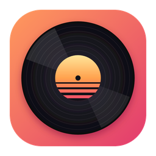

# MySpotify

**Spotify を本物のデスクトップアプリで**

ネイティブの画面、スクロールする歌詞、MV と動画ポッドキャスト。無料アカウントでも曲をフルで聴けて、ログインしなくても中を見て回れます。

[English](README.md) · [简体中文](README.zh-CN.md) · [繁體中文](README.zh-TW.md) · **日本語** · [Italiano](README.it.md)

[](https://github.com/margbug01/MySpotify/actions/workflows/test.yml) [](https://github.com/margbug01/MySpotify/releases/latest)   

**[最新版をダウンロード](https://github.com/margbug01/MySpotify/releases/latest)** · [ウェブサイト](https://margbug01.github.io/MySpotify/en.html)（英語） · [インストール](#はじめかた) · [よくある質問](#よくある質問)

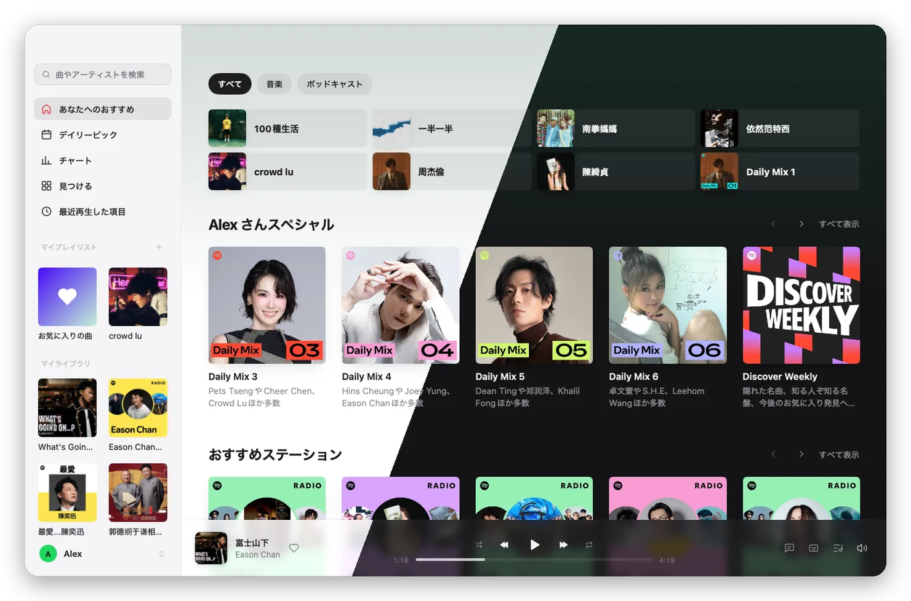

</div>

Linux 向けに実験的な `.deb` / `.tar.gz` ビルドがあります。amd64 では Qt WebEngine バックエンドが標準で、ログインと再生が同じエンジンを使います。WSLg 上で、既存のログインの移行、再起動後の更新、75 秒間の実際の音楽再生を確認済みで、Chrome は起動しません。別途 Qt ランタイムと、公式 Chrome の Widevine コンポーネントが必要です。Linux はまだ安定してサポートしているプラットフォームではありません。インストール手順、メモリの測定結果、制限は [Linux のリリースノート](LINUX.md#qt-webengine-后端2026-11-10)（中国語）を見てください。

> [!IMPORTANT]
> MySpotify は個人のプロジェクトで、Spotify とは関係がなく、Spotify の承認も受けていません。公開 API ではなく Spotify のウェブプレーヤーの内部インターフェースを使っているので、Spotify がいつ変更してもおかしくありません。この使い方は Spotify の利用規約に反する可能性が高く、アカウントが制限されるおそれがあります。自分のアカウントだけを使い、自己責任で利用してください。詳しくは[「リスクと限界」](#リスクと限界)を見てください。

## 使う理由

| | |
| --- | --- |
| **デスクトップアプリらしい** | 画面は [MyGo](https://github.com/egoist/mygo) がネイティブに描いていて、ウェブページを枠に入れたものではありません。サイドバー、再生バー、全画面の再生画面、リズムに合わせて動くステージ、システムのメディアキー、グローバルショートカット、ライトとダークのテーマがそろっています。ウインドウを閉じても、システムトレイから再生が続きます。閲覧中のメモリ使用量は約 190 MB で、再生中は約 60 MB の復号プロセスが加わります。 |
| **ログインしなくても見て回れる** | 起動してすぐに、検索、ホーム、プレイリスト、アルバム、アーティストを見られます。MySpotify はウェブプレーヤーと同じようにゲスト ID を自分で取得し、コールドスタートから 1、2 秒で中身が表示されます。聴きたくなったらログインしてください。 |
| **無料アカウントでも曲をフルで** | ログインは Spotify 公式のページで行います。音声はシステムのウェブコンポーネントに組み込まれた DRM モジュールが復号します。ブラウザで聴くのと同じ経路で、128k AAC です。Windows では WebView2 の Widevine、macOS では WebKit の FairPlay を使います。 |
| **ほとんどの曲に歌詞があり、スクロールする** | Spotify にない歌詞は、NetEase Cloud Music と LRCLIB から探します。タイムタグ付きの歌詞を優先し、曲名と長さが合うものだけを使うので、別バージョンの歌詞が混ざりません。外国語の曲に中国語訳がある場合は、各行の下に訳が 1 行表示されます。Mac と Windows では、再生バーの「デスクトップ歌詞」を使うと、歌っている行がすべてのウインドウの前面に浮かび、歌った文字がカバーの色で光ります。ロックすると、クリックが通り抜けます。文字サイズ、色、2 行目に訳と次の行のどちらを表示するかは「設定 › デスクトップ歌詞」で変えられます。 |
| **MV も見られる** | MV がある曲には小さな「MV」タグが付いていて、クリックすると再生します。再生バーと再生画面からもいつでも切り替えられます。カバーの位置、ウインドウいっぱい、全画面のどれでも見られ、下に今の歌詞が表示されます。歌詞がずれているときは `[` / `]` で 0.5 秒ずつ調整でき、曲ごとに記憶されます。 |
| **ポッドキャストを聴いて、見て、読める** | 動画ポッドキャストは「動画」をクリックすると映像が見られます。文字起こしは歌詞のようにスクロールし、単語ごとに光ります。文をクリックすると、その位置へ移動します。 |
| **Spotify の機能のほとんどがある** | ホーム、デイリーミックス、チャート、すべてのカテゴリ、プレイリストとアルバム、アーティストと曲のページ、プロフィール、検索、お気に入り、フォロー、保存、自分のプレイリストの編集、次に再生と再生キュー、ラジオ、最近再生した項目。ウェブやスマートフォンで追加したプレイリストは自動で同期されます。 |
| **スマートフォンとコンピュータで引き継げる（実験的）** | コンピュータがスマートフォンの Spotify のデバイス一覧に表示され、タップすると再生がコンピュータに移ります。スマートフォンで再生している間も、コンピュータから状態を見て操作できます。[詳しく](#スマートフォンとコンピュータの引き継ぎ実験的) |
| **エラーで止まらない** | ライセンスが切れたら、新しい ID を取得して再試行します。リクエストが制限されたら、Spotify が指定した時間だけ待ってから元の位置で再開します。ネットワークが切れたら、戻ったときに再開します。ウェブプレーヤーの更新で古いクエリが使えなくなったら、MySpotify が公開中のスクリプトから新しいクエリを自分で見つけます。 |
| **同じ曲を 2 回ダウンロードしない** | 再生した曲は、届いたときの暗号化された断片のままコンピュータに残ります。次からは再生が速く、通信量もかかりません。上限は設定で選べ、まとめて消去もできます。 |
| **データはコンピュータの中だけ** | 分析もトラッキングもありません。接続先は Spotify、Gravatar（アカウントのメールアドレスのアバター用）、歌詞を探すときの NetEase と LRCLIB（送るのは曲名、アーティスト、アルバム、長さだけ）、アップデート確認時の GitHub だけです。[データの保存場所](#設定とログイン情報はどこに保存されますか) |

## スクリーンショット

<table>
  <tr>
    <td width="50%">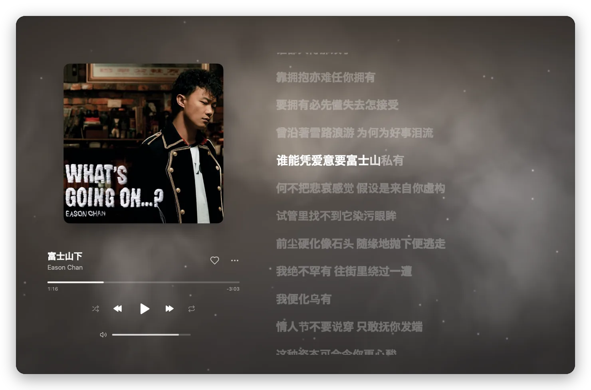</td>
    <td width="50%">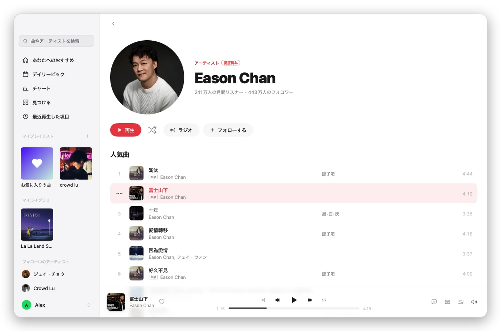</td>
  </tr>
  <tr>
    <td>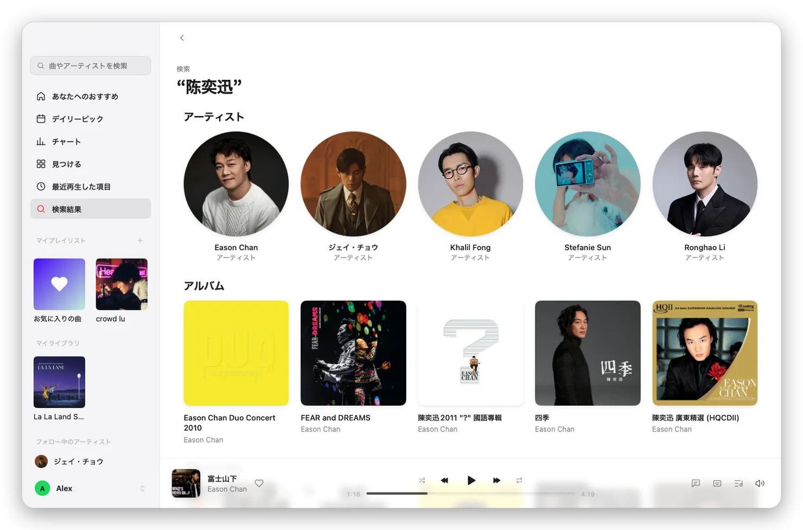</td>
    <td>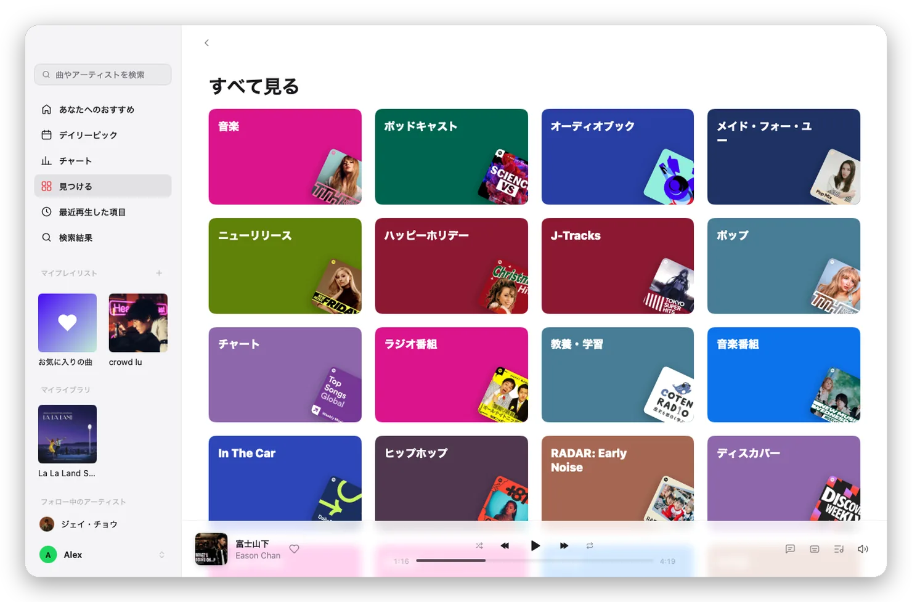</td>
  </tr>
  <tr>
    <td>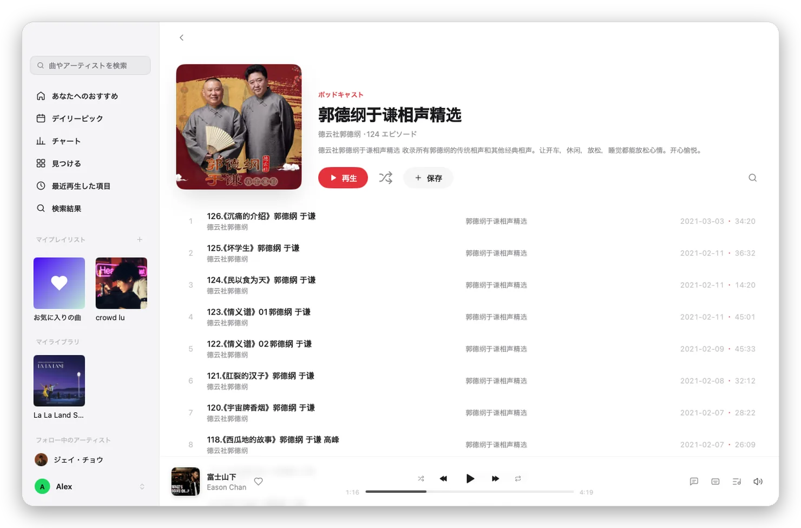</td>
    <td>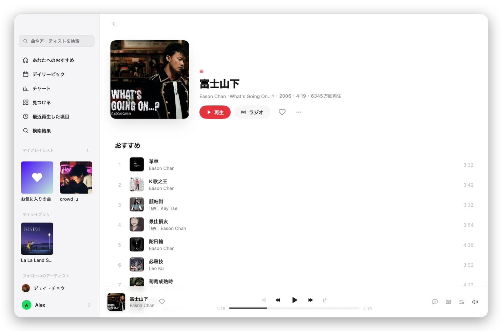</td>
  </tr>
</table>

<details>
<summary>その他のスクリーンショット</summary>

<table>
  <tr>
    <td width="50%">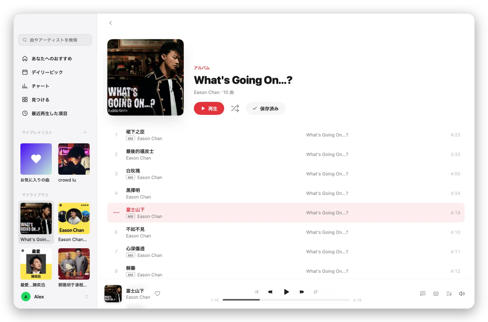</td>
    <td width="50%">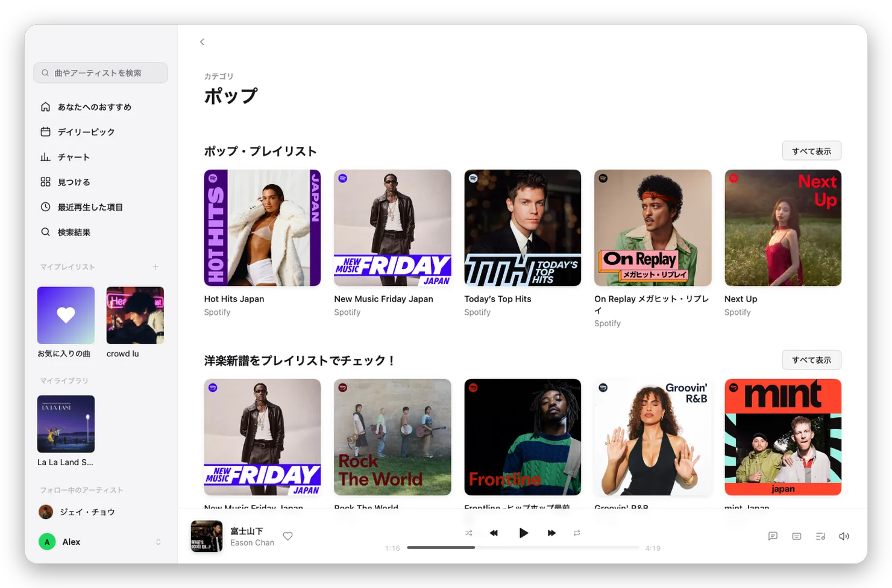</td>
  </tr>
  <tr>
    <td>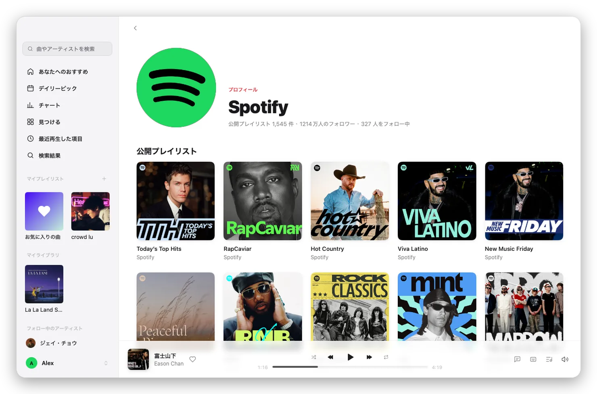</td>
    <td></td>
  </tr>
</table>

</details>

## はじめかた

v0.4.45 から画面を日本語で表示できます。「設定 › 外観 › 言語」で「システムに合わせる」、简体中文、繁體中文、English、Italiano、日本語のどれかを選ぶと、すぐに切り替わり、選択が保存されます。システムの言語が日本語なら、「システムに合わせる」で日本語になります。曲名、アーティスト名、歌詞は元の内容のまま表示されます。

### Windows

1. [Releases](https://github.com/margbug01/MySpotify/releases/latest) から `MySpotify-<バージョン>-windows-amd64.zip` をダウンロードし、好きなフォルダに展開して `MySpotify.exe` をダブルクリックします。
2. exe にはコード署名がないので、初回は「Windows によって PC が保護されました」と表示されることがあります。その場合は「詳細情報 › 実行」をクリックします。確かめたい場合は、Release に書かれた sha256 と照合するか、[自分でビルド](DEVELOPMENT.en.md#build-from-source)（英語）してください。
3. Windows 10 または 11 と、[WebView2 ランタイム](https://developer.microsoft.com/microsoft-edge/webview2/)が必要です（Windows 11 には含まれていて、ほとんどの Windows 10 にも入っています）。

アップデート：0.4.0 以降は「設定 › このアプリについて」で「アップデートして再起動」をクリックします。新しいバージョンがあると、サイドバーの左下に表示されます。0.3.0 以前から移行する場合は、1 回だけ手動で更新します。トレイアイコンを右クリックして MySpotify を終了し、古いファイルを新しいファイルで上書きしてから起動してください。設定とログイン情報は exe の隣に保存されていないので、消えません。

### macOS（Apple シリコン / Intel）

1. Apple シリコンなら `MySpotify-<バージョン>-macos-arm64.dmg`、Intel なら `MySpotify-<バージョン>-macos-amd64.dmg`（実験版）をダウンロードします。開いて、MySpotify を「アプリケーション」にドラッグします。
2. このアプリは Apple の公証を受けていないので、初回の起動はブロックされます。「システム設定 › プライバシーとセキュリティ」の一番下で「このまま開く」をクリックしてください。または、ターミナルで `xattr -dr com.apple.quarantine /Applications/MySpotify.app` を実行してから開きます。

Intel ビルドはクロスコンパイルとパッケージの検査を通っています。ログイン、音楽と MV の再生、アプリ内アップデートは、まだ Intel の実機で確認できていません。問題があったら、Mac の機種、macOS のバージョン、エラーログを [#15](https://github.com/margbug01/MySpotify/issues/15) に書いてください。

アップデート：0.4.0 以降は「設定 › このアプリについて」で「アップデートして再起動」をクリックします。メニューの「MySpotify › アップデートを確認…」も使えます。アプリは「アプリケーション」など書き込める場所に置く必要があり、dmg の中から開いたものは自分で更新できません。0.3.0 から移行する場合は、1 回だけ手動で更新します。古いバージョンを終了し、「アプリケーション」にある古いものを新しいもので上書きしてください。設定とログイン情報はアプリの中に保存されていないので、消えません。

### ログイン

どちらの OS でも同じです。「Spotify にログイン」をクリックし、開いた Spotify のページでログインします。ログイン情報はコンピュータに残るので、次回からはログインし直す必要はありません。

### ショートカット

| 操作 | キー（macOS では Ctrl の代わりに ⌘） |
| --- | --- |
| 再生 / 一時停止 | `Space` |
| 前の曲 / 次の曲 | `Ctrl+←` / `Ctrl+→` |
| 再生中の曲をお気に入りに追加 | `Ctrl+D` |
| 再生画面を開く | `Ctrl+L` |
| 検索 | `Ctrl+F` |
| 新規プレイリスト | `Ctrl+N` |
| 設定 | `Ctrl+,` |
| 進む / 戻る | マウスのサイドボタン |
| MV：全画面 / 1 段階ずつ戻る | `F` / `Esc` |
| MV：歌詞を 0.5 秒早める / 遅らせる | `[` / `]` |

「設定 › グローバルショートカット」では、再生/一時停止、次の曲、前の曲にキーの組み合わせを 1 つずつ割り当てられます。ほかのアプリを使っているときも使えます。

### 再生中の曲を AppleScript で読む（macOS）

スクリプトから、再生中の内容を読み取れます（変更はできません）。書き方は「ミュージック」とほぼ同じです。

```applescript
tell application "MySpotify"
	set {state, pos, rate, t} to {player state, player position, player rate, current track}
end tell
if t is not missing value then return name of t & " - " & artist of t & " (" & kind of t & ")"
```

- `player state`：`playing` または `paused`。何も読み込まれていないときは `stopped`
- `player position`：再生位置（秒）。`player rate`：再生速度。エピソードはポッドキャスト用に選んだ速度、曲は 1
- `current track`：`id`（`spotify:track:…` のような Spotify URI）、`name`、`artist`、`album`、`duration`（秒）、`kind`（`song` または `episode`）を持つレコード。何も読み込まれていないときは、`player position` と同じく `missing value` です。オブジェクトではなくレコードなので、1 つのフィールドを取り出すには `name of (get current track)` と書くか、上の例のように変数に入れてから使います

ほかのアプリ（スクリプトエディタ、ターミナルの `osascript`）から初めて問い合わせるときは、MySpotify の操作を許可するかを macOS が尋ねます。許可してください。

## スマートフォンとコンピュータの引き継ぎ（実験的）

- **コンピュータで再生する**：スマートフォンかウェブの Spotify のデバイス一覧で「MySpotify · コンピュータ名」を選びます。コンピュータの再生キューはスマートフォンに表示されるものと同じで、その中の曲をクリックすると、元のプレイリストの中でその曲に移ります（Spotify がこれを受け付けないことがあります。下を見てください）。
- **コンピュータからスマートフォンを操作する**：画面下部の音量の隣にある「再生デバイス」に、同じアカウントでオンラインのスマートフォン、ウェブプレーヤー、このコンピュータが表示されます。ほかのデバイスで再生しているときは、コンピュータにその曲と再生位置が表示され、再生/一時停止、前の曲/次の曲、シーク、音量、シャッフル、リピートの操作がそのデバイスに送られます。
- **Google Cast スピーカー**：同じネットワークにある Google Cast と Nest のスピーカー（マルチルームのグループを含む）も「再生デバイス」に表示されます。スピーカーで Spotify を開いていなくてもかまいません。クリックするとスピーカーを起動してから再生を移します。初めて「再生デバイス」を開くと、ローカルネットワークへのアクセスを許可するかを macOS が尋ねます。許可してください。
- 音が出るのは一度に 1 台のデバイスだけです。再生が別のデバイスに移ったり、接続が切れたりすると、コンピュータ側は止まるので、2 台が同時に鳴ることはありません。

この機能はまだ実験段階です。無料アカウントでの登録と引き継ぎはテストで動いていますが、長時間の接続や、あらゆるデバイスの組み合わせはまだ十分に試せていません。ときどき「Spotify がこの操作を受け付けませんでした」と表示されることがあります。Spotify が返した理由はログ `vinyl.log` に記録されるので（`connect:` で検索）、その行を issue に貼ってもらえると助かります。

## リスクと限界

- **公式クライアントではありません。** データはウェブプレーヤーの Pathfinder GraphQL と spclient のインターフェースから取得しています。どちらも公開ドキュメントがなく、Spotify が変更すると MySpotify は動かなくなります。
- **ゲスト ID。** ログインしていないとき、MySpotify はウェブプレーヤーと同じ方法で匿名の ID を取得し、Spotify が全員に公開している内容だけを表示します。曲を聴くには、自分のアカウントでのログインが必要です。
- **規約。** Spotify の利用規約は、サードパーティのプログラムからサービスにアクセスすることを認めていません。MySpotify を使うと、アカウントが制限されたり停止されたりする可能性があります。自分のアカウントだけを使い、商用には使わないでください。
- **広告。** ウェブプレーヤーの無料プランでは広告が流れますが、MySpotify は流しません。Spotify はこれを快く思わないでしょう。気になる場合は、公式クライアントを使うか Premium に登録してください。
- **鍵には触れません。** MySpotify は DRM を破りません。復号は WebView2 の Widevine または WebKit の FairPlay のモジュールの中で行われ、プログラムは鍵も、復号後の音声と映像も受け取りません（そのため、macOS でのスクリーンショットや録画では MV の映像が黒くなります）。プログラムが読むのは、ファイルヘッダーに書かれた暗号化方式と鍵 ID だけで、曲が再生できない理由をログで説明するために使います。キャッシュに入っているのは CDN から届いた暗号化された断片で、再生のたびに Spotify にライセンスを求めるので、オフラインでは使えません。
- **歌詞の取得元。** 歌詞の補完に使う NetEase のインターフェースには公開ドキュメントがなく、頻繁に検索すると制限がかかり、いつ変わってもおかしくありません。NetEase と LRCLIB が受け取るのは、曲名、アーティスト、アルバム、長さだけです。
- **再生の開始を繰り返しすぎないでください。** ライセンスのインターフェースにはデバイスごとの制限があります。短い時間に何度も再生を開始すると（たとえば 30 分に十数回）、しばらく 429 が返されます。

## できないこと

| 機能 | 理由 |
| --- | --- |
| ロスレス音質 | 公式のデスクトップアプリとスマートフォンアプリだけの機能です。256k は Premium アカウント向けで、「設定 › 音質」で「高音質（256k）」をオンにします。無料アカウントで 256k のライセンスを求めると拒否され（403）、その曲は 128k で再生されます |
| 単語単位の歌詞 | Spotify がウェブプレーヤーに渡すのは行単位のタイミングだけです。NetEase の単語単位の歌詞にはまだ対応していません |
| オフライン再生用のダウンロード | Premium と公式クライアントが必要です |
| Jam、DJ | Premium かスマートフォンアプリが必要です |
| macOS での一部のポッドキャスト | Spotify がホストし、Widevine で暗号化した音声しかない番組は、FairPlay では復号できません。動画ポッドキャストと、元の音声のアドレスがある番組はすべて再生できます |
| ポッドキャストの文字起こしの中国語訳 | 文字起こしは元の言語と、Spotify が用意したいくつかの外国語訳だけで、中国語はありません |
| スペクトラム | 音声は復号モジュールの中にあって取り出せません。再生中の小さなバーは、再生位置から計算したアニメーションです |
| Intel Mac、Linux | 実験的なインストーラーで、まだ安定したサポートではありません。Intel 版は実機での確認が必要で、Linux には別の[インストール手順](LINUX.md)（中国語）があります |
| MV と歌詞の正確な同期 | Spotify は MV と元の曲のずれを教えてくれないので、長さから推定しています。ずれているときは `[` / `]` で調整してください |
| 友達のアクティビティ、ローカルファイル、Blend | まだ作っていません |

## よくある質問

<details>
<summary>曲を再生すると「この曲は現在再生できません」と表示されるのはなぜですか？</summary>

その曲がお住まいの地域で配信されていないか、Spotify がライセンスを拒否しました（403）。ウェブプレーヤーでも再生できない場合は、権利の問題です。ログ `vinyl.log`（Windows は `%APPDATA%\Vinyl`、macOS は `~/Library/Application Support/Vinyl`）に正確な理由が書かれています。
</details>

<details>
<summary>再生バーに「Spotify がリクエストを制限しています」と表示されたら、どうすればいいですか？</summary>

何もしなくてかまいません。MySpotify は Spotify が指定した時間だけ待ってから、元の位置で再開します。制限の対象は MySpotify というデバイスなので、ブラウザのウェブプレーヤーには影響しません。
</details>

<details>
<summary>歌詞がない、または歌詞がスクロールしないのはなぜですか？</summary>

Spotify、NetEase、LRCLIB のどれにも歌詞がないか、タイムタグのないテキストしかありません（その場合は静止表示で、スクロールも、行をクリックしての移動もできません）。カバー曲やライブ版は、長さが合うときだけ使います。別バージョンの歌詞を表示するくらいなら、表示しないほうを選びます。歌詞サイトが混んでいるときは、3 秒後と 10 秒後にもう一度問い合わせ、その間は読み込み中の灰色のバーを表示します。
</details>

<details>
<summary>「デイリーピック」のページが空なのはなぜですか？</summary>

新しいアカウントは、しばらく聴かないと Spotify が Daily Mix を作りません。それまではこのページに何も表示されません。
</details>

<details>
<summary>曲がキャッシュされているのに、ネットワークが必要なのはなぜですか？</summary>

キャッシュにあるのは暗号化された音声で、復号には Spotify がその場で発行するライセンスが必要です。キャッシュで節約できるのは、通信量とバッファリングの時間です。
</details>

<details>
<summary>プロキシはどう設定しますか？</summary>

標準ではシステムのプロキシを使います。Windows は「設定 › ネットワークとインターネット › プロキシ」、macOS は「システム設定 › ネットワーク › 詳細 › プロキシ」です。環境変数 `HTTPS_PROXY` があれば、そちらが優先されます。MySpotify の「設定 › ネットワーク › プロキシ」に `127.0.0.1:7890`、`http://…`、`https://…`、`socks5://…` を入力することもできます。
</details>

<details>
<summary>macOS のスクリーンショットや録画で MV の映像が黒いのはなぜですか？</summary>

MV は FairPlay で暗号化されていて、macOS は暗号化された映像をスクリーンショットや録画のソフトウェアに渡しません。Safari で Apple TV+ を見るときと同じです。画面と歌詞は普通にキャプチャできます。
</details>

<details>
<summary>ログアウトやアカウントの切り替えはどうしますか？</summary>

左下のアバターをクリックして、ログアウトを選びます。WebView に残っている Spotify のログイン情報が消去されます。
</details>

<details>
<summary>ウインドウを閉じても音楽が止まらないのはなぜですか？完全に終了するには？</summary>

ウインドウを閉じても、アプリはトレイに入るだけで、音楽は再生を続けます。トレイアイコンをクリックするか、MySpotify をもう一度開くと戻ります。終了するには、トレイアイコンを右クリックして「MySpotifyを終了」を選びます。「設定」で「ウインドウを閉じたら終了」をオンにすることもできます。
</details>

### 設定とログイン情報はどこに保存されますか？

| 内容 | Windows | macOS |
| --- | --- | --- |
| 設定、再生位置、このコンピュータでの再生履歴、ログ | `%APPDATA%\Vinyl` | `~/Library/Application Support/Vinyl` |
| ログイン情報 | `%LOCALAPPDATA%\Vinyl\WebView2` | `~/Library/WebKit/dev.margbug.vinyl` |
| セッション更新用の Cookie（暗号化済み） | `%LOCALAPPDATA%\Vinyl\account-cookies` | `~/Library/Application Support/Vinyl/account-cookies` |

Cookie は暗号化して保存されます。Windows では DPAPI で現在のユーザーに結び付け、macOS では鍵をログインキーチェーンに置いています。そのため、ファイルだけをコピーしても開けません。ログアウトしたときや、ログインが切れたときに削除されます。フォルダ名が Vinyl なのは、このプロジェクトの元の名前だからです。名前を変えたときにフォルダ名を変えなかったのは、全員がログアウトされないようにするためです。

## 開発に参加する

仕組み、ソースからのビルド、リリース、デバッグは **[開発ガイド](DEVELOPMENT.en.md)**（英語）にまとめてあります。

## 謝辞

- 画面は [egoist/mygo-cloudmusic](https://github.com/egoist/mygo-cloudmusic)（NetEase Cloud Music のクライアント）から来ていて、データと再生を Spotify のものに置き換えています。リポジトリは上流の履歴を残しているので、`git merge upstream/main` で作者の画面の更新を取り込めます。
- [MyGo](https://github.com/egoist/mygo)：Go のネイティブ UI フレームワーク。
- [hls.js](https://github.com/video-dev/hls.js)（Apache-2.0）。`internal/player/web/hls.min.js` にあります。
- [Flutify](https://github.com/is-hp-is-mad/Flutify)：Connect プロトコルの構造の参考にしました。
- [OpenCC](https://github.com/BYVoid/OpenCC)（Apache-2.0）：歌詞の簡体字と繁体字の変換表。
- 歌詞は [LRCLIB](https://lrclib.net/) と NetEase Cloud Music から取得しています。

## リンク

- [LINUX DO](https://linux.do/)：誠実で、親しみやすく、団結した、プロフェッショナルなオープンソースとギークのコミュニティ

## ほかのアプリ

同じ作者による MyGo アプリ：[Mami](https://github.com/margbug01/mami) · [MyShoes](https://github.com/margbug01/ShoesGUI) · [Candle](https://github.com/margbug01/Candle)

## ライセンス

[AGPL-3.0](LICENSE)。上流と同じです。[`licenses/`](licenses) には、プログラムに組み込まれたサードパーティのコードのライセンスが入っていて、プログラムと一緒に配布されます（Windows では exe の隣、macOS ではアプリの Resources の中）。アイコンは MySpotify のオリジナルです（`tools/icons.py`、「回るレコード」：3 本の溝が光を受けるビニールレコード）。Spotify は Spotify AB の商標です。MySpotify という名前は、何を再生するかを示しているだけです。スクリーンショットのカバーと写真の権利は、それぞれの権利者に帰属します。
