

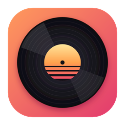

# MySpotify

**把 Spotify 放进真正的桌面软件**

原生界面，会滚动的歌词，MV 和视频播客。免费账号也能整首播放，不登录也能先逛。

**简体中文** · [English](README.en.md)

   

**[下载最新版](https://github.com/margbug01/MySpotify/releases/latest)** · [官网](https://margbug01.github.io/MySpotify/) · [安装步骤](#开始使用) · [常见问题](#常见问题)

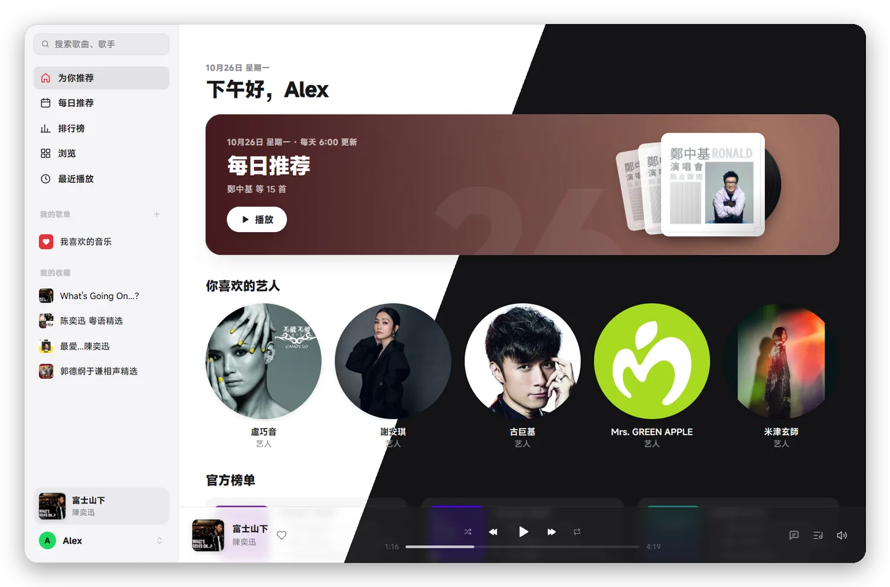

Linux 提供实验性 `.deb` / `.tar.gz` 构建。amd64 默认使用 Qt WebEngine 后端，已在 WSLg 验证已有登录迁移、重启续期和 75 秒真实音乐播放，登录与播放共用引擎，无需启动 Chrome 浏览器。需另装 Qt 运行时及官方 Chrome 的 Widevine 组件，尚不属于稳定支持平台。安装方法、内存实测及限制见 [Linux 发版说明](LINUX.md#qt-webengine-后端2026-11-10)。

> [!IMPORTANT]
> MySpotify 是个人项目，和 Spotify 没有任何关系，也没有得到它的认可。它用的是 Spotify 网页播放器自己的内部接口，不是公开 API，Spotify 随时可能改掉；这样用 Spotify 很可能不符合它的用户条款，账号有被限制的风险。只用你自己的账号，后果自负。详见[「风险和边界」](#风险和边界)。

## 为什么用它

| | |
| --- | --- |
| **像个桌面软件** | 界面是 [MyGo](https://github.com/egoist/mygo) 画的原生界面，不是套一层网页：侧栏、播放栏、全屏播放页、律动舞台、系统媒体键、全局快捷键、深浅色主题都有。关窗口收进托盘接着放。只浏览时整个程序约 190MB，放歌时多一个约 60MB 的解密进程。 |
| **不登录也能逛** | 打开就能搜索，看首页、歌单、专辑和艺人页：MySpotify 像网页播放器一样自己取一个访客身份，冷启动一两秒就有内容。要听歌再登录。 |
| **免费账号整首放** | 登录走 Spotify 官方的登录页。音频由系统网页组件自带的 DRM 模块解密，和你在浏览器里听是同一条路，128k AAC：Windows 上是 WebView2 的 Widevine，macOS 上是 WebKit 的 FairPlay。 |
| **歌词基本都有，而且会滚** | Spotify 没有的，去网易云和 LRCLIB 找，带时间轴的优先，按歌名和时长核对版本，不乱配。外语歌有中文翻译时，每句原文下面显示一行翻译。 |
| **能看 MV** | 有 MV 的歌带个「MV」小标，点它就放，播放栏和播放页也能随时切换。可以放在封面的位置、铺满窗口或者全屏，下方显示当前这句歌词。歌词不准的话按 `[` / `]` 每次调 0.5 秒，按歌记住。 |
| **播客能听、能看、能跟读** | 视频播客点「视频」就看画面。逐字稿像歌词一样跟着滚，一个词一个词亮起，点一句就跳过去。 |
| **Spotify 有的大部分都在** | 首页、每日推荐、排行榜、浏览全部分类、歌单和专辑、艺人页、单曲页、个人主页、搜索、喜欢、关注、收藏、自建歌单的增删改、下一首播放和待播清单、电台、最近播放。网页或手机上新加的歌单会自己同步过来。 |
| **手机和电脑能接力（实验性）** | 电脑会出现在手机 Spotify 的设备列表里，点它就转到电脑上放；手机在放时，电脑这边也能看到、能遥控。[详情](#手机和电脑接力实验性) |
| **出错不会卡死** | 许可证过期自动换身份重试；被限流时按 Spotify 要求的时间等完，从原位置接着放；断网了等网络回来接着放。Spotify 更新网页播放器、旧的查询失效时，MySpotify 会自己去线上脚本里找新的。 |
| **听过的不用再下** | 放过的歌（加密分段，原样存下）留在本机，再放更快、不耗流量；上限可以在设置里选，也能一键清除。 |
| **数据只在本机** | 没有统计和跟踪。只连 Spotify、Gravatar（取账号邮箱的头像）、查歌词时的网易云和 LRCLIB（只收到歌名、歌手、专辑和时长），以及检查更新时的 GitHub。[数据存在哪](#设置和登录态存在哪) |

## 截图

<table>
  <tr>
    <td width="50%">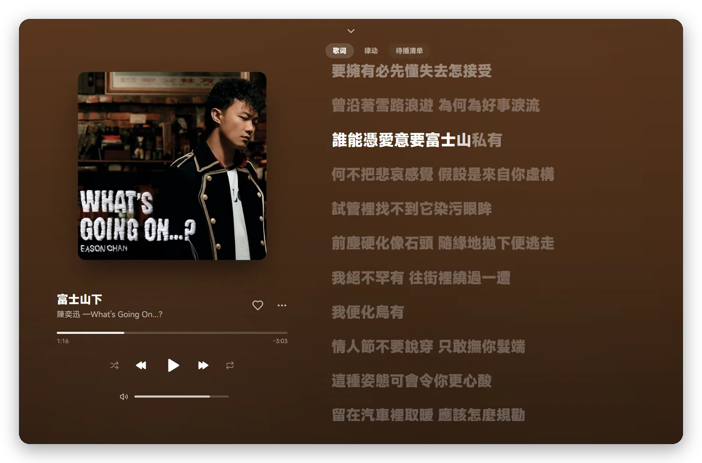</td>
    <td width="50%">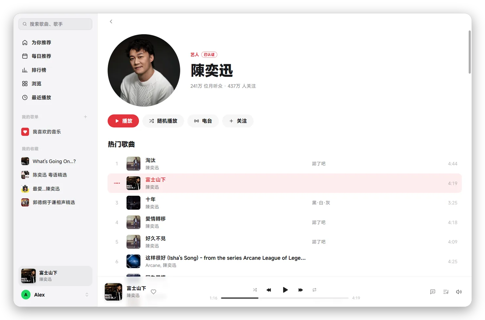</td>
  </tr>
  <tr>
    <td>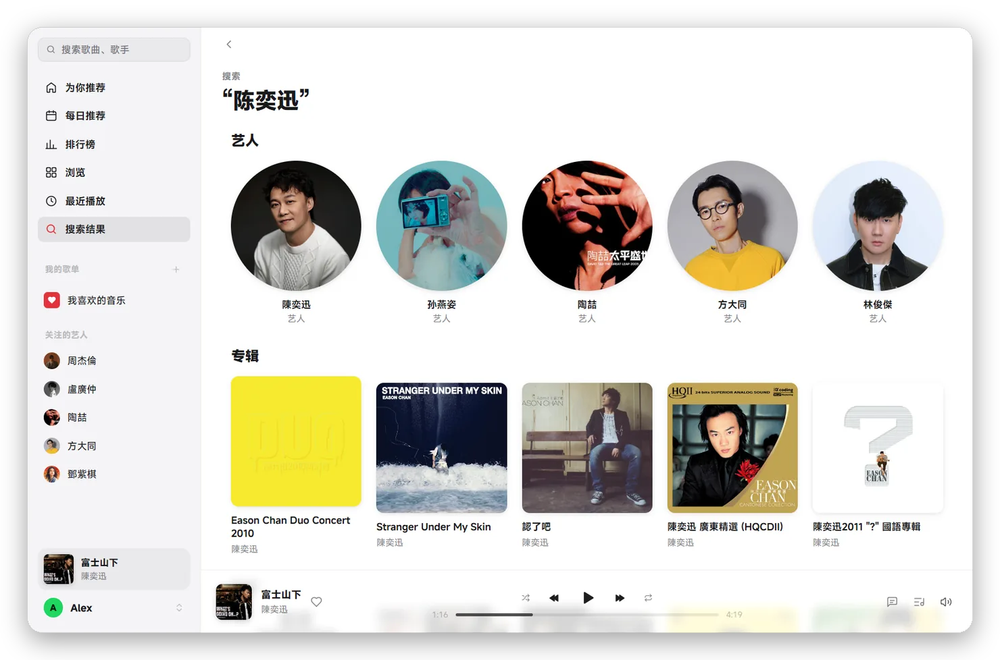</td>
    <td>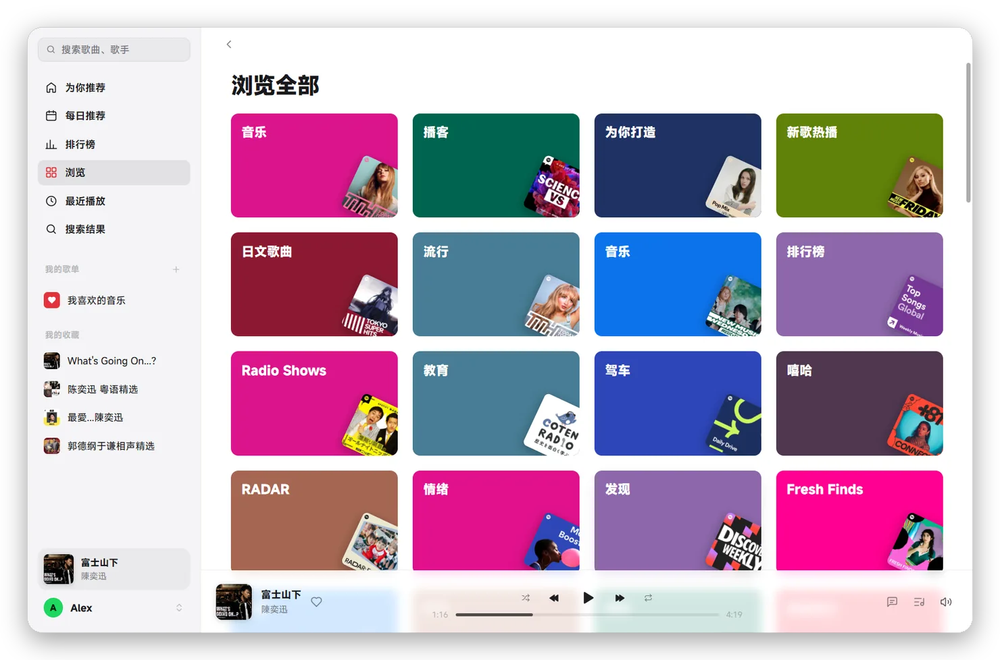</td>
  </tr>
  <tr>
    <td>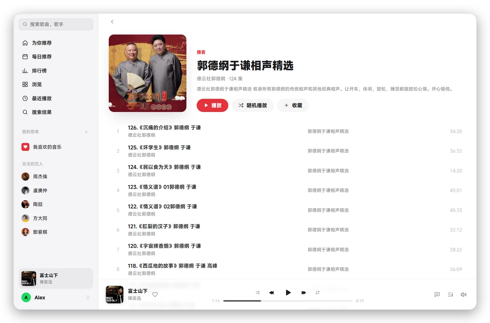</td>
    <td>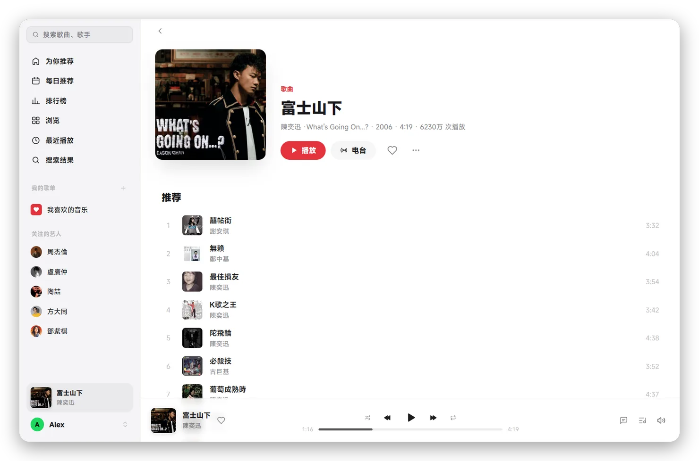</td>
  </tr>
</table>

更多截图

<table>
  <tr>
    <td width="50%">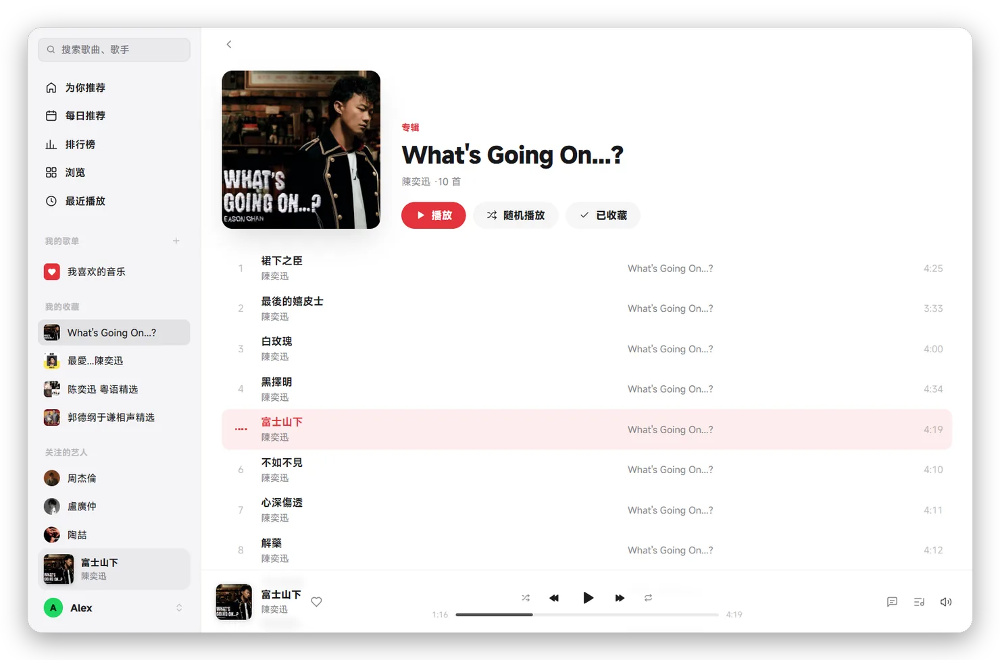</td>
    <td width="50%">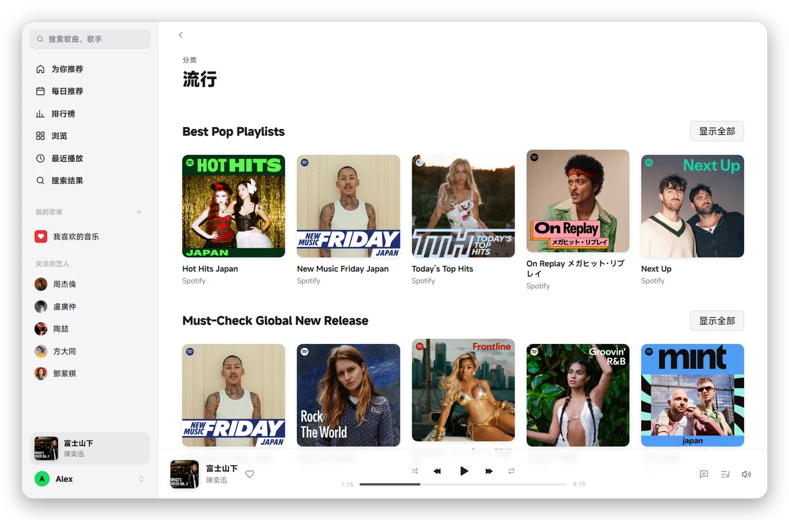</td>
  </tr>
  <tr>
    <td>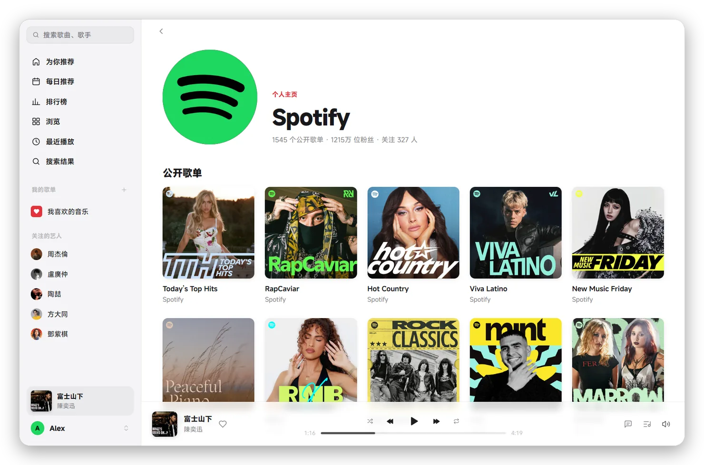</td>
    <td></td>
  </tr>
</table>

## 开始使用

### Windows

1. 到 [Releases](https://github.com/margbug01/MySpotify/releases/latest) 下载 `MySpotify-<版本>-windows-amd64.zip`，解压到任意文件夹，双击 `MySpotify.exe`。
2. exe 没有代码签名，第一次打开 Windows 可能弹「Windows 已保护你的电脑」：点「更多信息 › 仍要运行」。不放心可以对一下 Release 里写的 sha256，或者按[开发说明](DEVELOPMENT.md#从源码构建)自己编。
3. 需要 Windows 10 或 11，以及 [WebView2 运行时](https://developer.microsoft.com/microsoft-edge/webview2/)（Windows 11 自带，Windows 10 大多也已经装了）。

升级：0.4.0 起在「设置 › 关于」里点「更新并重启」就行，有新版本时侧边栏左下角会提示。从 0.3.0 及更早的版本升上来要手动一次：右键托盘图标 › 退出 MySpotify，用新的文件覆盖旧的再打开。设置和登录都不在 exe 旁边，不会丢。

### macOS（Apple 芯片）

1. 下载 `MySpotify-<版本>-macos-arm64.dmg`，打开后把 MySpotify 拖进「应用程序」。
2. app 没有经过 Apple 公证，第一次打开会被拦下：到「系统设置 › 隐私与安全性」最下面点「仍要打开」。也可以在终端里执行 `xattr -dr com.apple.quarantine /Applications/MySpotify.app` 再打开。

升级：0.4.0 起在「设置 › 关于」里点「更新并重启」（菜单「MySpotify › 检查更新…」也行）；app 要在能写入的地方，比如「应用程序」，还在 dmg 里打开的不能自己更新。从 0.3.0 升上来要手动一次：退出旧版，用新的覆盖「应用程序」里的旧版。设置和登录不在 app 里，不会丢。

### 登录

两边都是：点「登录 Spotify」，在弹出的 Spotify 官方登录页里登录。登录态会留在本机，下次打开不用再登。

### 快捷键

| 操作 | 按键（macOS 上 Ctrl 换成 ⌘） |
| --- | --- |
| 播放 / 暂停 | `空格` |
| 上一首 / 下一首 | `Ctrl+←` / `Ctrl+→` |
| 喜欢正在放的歌 | `Ctrl+D` |
| 打开播放页 | `Ctrl+L` |
| 搜索 | `Ctrl+F` |
| 新建歌单 | `Ctrl+N` |
| 设置 | `Ctrl+,` |
| 前进 / 后退 | 鼠标侧键 |
| 看 MV 时全屏 / 一级级退回 | `F` / `Esc` |
| 看 MV 时歌词提前 / 延后 0.5 秒 | `[` / `]` |

「设置 › 全局快捷键」还可以给播放/暂停、下一首、上一首各设一个组合键，切到别的应用也能用。

## 手机和电脑接力（实验性）

- **转到电脑放**：手机或网页 Spotify 的设备列表里选「MySpotify · 电脑名」。电脑的待播清单和手机上看到的是同一份，点其中一首会在原来的歌单里跳过去（这一步偶尔会被 Spotify 拒绝，见下）。
- **在电脑上管手机**：底部音量旁的「设备」能看到同账号在线的手机、网页和本机。别的设备在放时，电脑显示它的歌和进度，播放/暂停、上一首/下一首、拖进度、音量、随机/循环都发给那台设备。
- 同一时间只有一台设备出声。播放被转走、或者连接断了，电脑这边会停下，不会两边一起响。

这一块还在实验：免费账号的注册和接力实测能用，长时间挂着、各种设备组合还没测全。偶尔会提示「Spotify 没有接受这个操作」，Spotify 给的原因会写进日志 `vinyl.log`（搜 `connect:`），遇到了欢迎把那一行贴到 issue 里。

## 风险和边界

- **不是官方客户端。** 数据走网页播放器的 Pathfinder GraphQL 和 spclient 接口，这些都没有公开文档，Spotify 改了 MySpotify 就会坏。
- **访客身份。** 不登录时，MySpotify 用和网页播放器相同的办法取一个匿名身份，只看 Spotify 对所有人公开的内容；听歌仍然要登录自己的账号。
- **条款。** Spotify 的用户条款不允许用第三方程序访问它的服务。用 MySpotify 可能导致账号被限制或封禁。只用你自己的账号，别拿它做任何商业用途。
- **广告。** 网页播放器的免费版会插广告，MySpotify 不放。这一点 Spotify 很可能不喜欢；如果你在意，请用官方客户端或订阅 Premium。
- **不碰密钥。** MySpotify 不破解 DRM：解密在 WebView2 的 Widevine 或 WebKit 的 FairPlay 模块里完成，程序拿不到密钥，也拿不到解密后的音频和画面（所以在 macOS 上截图、录屏时 MV 画面是黑的）。程序只读文件头里写明的加密方式和密钥编号（key ID），用来在日志里说清某首歌为什么放不了。缓存里存的是 CDN 给的加密分段，每次播放仍要向 Spotify 申请许可证，不能离线。
- **歌词来源。** 补歌词用的网易云接口没有公开文档，频繁搜索会被它限流，哪天也可能改掉；它和 LRCLIB 都只收到歌名、歌手、专辑和时长。
- **别频繁起播。** 许可证接口按设备限流，短时间里反复起播（比如半小时十几次）会被 429 一阵子。

## 做不了的

| 功能 | 为什么 |
| --- | --- |
| 256k / 无损音质 | 免费号申请 256k 的许可证会被拒（403）；无损只在官方桌面和手机 App 里 |
| 逐字歌词 | Spotify 只给网页播放器逐行时间；网易云的逐字歌词还没接 |
| 离线下载 | 需要 Premium，而且要官方客户端 |
| Jam、DJ | 需要 Premium 或手机端 |
| macOS 上部分播客 | Spotify 自己托管、只给 Widevine 加密音频的节目（比如忽左忽右），FairPlay 解不了；视频播客和有原始音频地址的节目都能放 |
| 播客字幕的中文翻译 | 逐字稿只有原文和 Spotify 给的几种外语翻译，没有中文 |
| 频谱 | 音频在解密模块里，拿不到；播放中的小音柱是按位置算的动画 |
| Intel Mac、Linux | 目前只有 Windows 和 Apple 芯片 Mac 的安装包 |
| MV 和歌词精确对齐 | Spotify 不给 MV 和原曲之间差多少，只能按时长估，偏了用 `[` / `]` 手动调 |
| 好友动态、本地文件、Blend | 暂时没做 |

## 常见问题

为什么点了播放显示「这首歌暂时无法播放」？

这首歌在你所在地区不可播，或者 Spotify 拒绝了许可证（403）。同一首在网页版也放不了的话，就是版权问题。日志 `vinyl.log`（Windows 在 `%APPDATA%\Vinyl`，macOS 在 `~/Library/Application Support/Vinyl`）里可以看到具体原因。

播放栏写「Spotify 暂时限流，稍后重试」怎么办？

什么都不用做。MySpotify 会按 Spotify 要求的时间等完，再从刚才的位置接着放。限流对象是 MySpotify 这个设备，浏览器里的网页版不受影响。

这首歌怎么没有歌词，或者歌词不会滚？

Spotify、网易云、LRCLIB 三家都没有，或者只有不带时间轴的纯文本（静态显示，不会滚、不能点歌词跳进度）。翻唱、现场版要时长对得上才会用，宁可不显示也不套别的版本。歌词站忙的时候会隔 3 秒、10 秒各再查一次，查歌词时显示的是加载中的灰条。

「每日推荐」是空的？

新账号要听一阵，Spotify 才会生成 Daily Mix，在那之前这一页没有内容。

为什么还要联网，缓存了不是可以离线吗？

缓存的是加密的音频，解密要用 Spotify 当场发的许可证。缓存省的是流量和缓冲时间。

代理怎么设？

默认跟随系统代理：Windows 在「设置 › 网络和 Internet › 代理」，macOS 在「系统设置 › 网络 › 详细信息 › 代理」，环境变量 `HTTPS_PROXY` 优先。也可以在 MySpotify 的「设置 › 网络 › 代理」里单独填 `127.0.0.1:7890`、`http://…`、`https://…` 或 `socks5://…`。

macOS 上截图、录屏，MV 画面怎么是黑的？

MV 是 FairPlay 加密的，macOS 不让任何截图、录屏软件拿到加密视频的画面，Safari 里看 Apple TV+ 也一样。界面、歌词照常能截。

怎么退出登录或者换账号？

左下角头像 › 退出登录，会清掉 WebView 里的 Spotify 登录态。

关掉窗口怎么还在放歌？怎么真正退出？

关窗口只是收进托盘，音乐照常放，点托盘图标或者再打开一次 MySpotify 就回来。要退出：右键托盘图标 › 退出 MySpotify。

### 设置和登录态存在哪？

| 内容 | Windows | macOS |
| --- | --- | --- |
| 设置、播放进度、本机播放记录、日志 | `%APPDATA%\Vinyl` | `~/Library/Application Support/Vinyl` |
| 登录态 | `%LOCALAPPDATA%\Vinyl\WebView2` | `~/Library/WebKit/dev.margbug.vinyl` |
| 续期用的 cookies（加密） | `%LOCALAPPDATA%\Vinyl\account-cookies` | `~/Library/Application Support/Vinyl/account-cookies` |

cookies 加密保存：Windows 用 DPAPI 绑定当前登录用户，macOS 的密钥放在登录钥匙串里，单拷走这个文件解不开，退出登录或登录失效时会删掉。文件夹叫 Vinyl 是这个项目原来的名字，改名时没动，免得大家被登出。

## 参与开发

实现原理、从源码构建、发版和调试都在 **[开发说明](DEVELOPMENT.md)** 里。

## 致谢

- 界面来自 [egoist/mygo-cloudmusic](https://github.com/egoist/mygo-cloudmusic)（一个网易云音乐客户端），数据和播放换成了 Spotify。仓库保留了上游历史，可以 `git merge upstream/main` 拉作者的界面更新。
- [MyGo](https://github.com/egoist/mygo)：Go 的原生界面框架。
- [hls.js](https://github.com/video-dev/hls.js)（Apache-2.0），在 `internal/player/web/hls.min.js`。
- [Flutify](https://github.com/is-hp-is-mad/Flutify)：Connect 协议结构的参考。
- 歌词来自 [LRCLIB](https://lrclib.net/) 和网易云音乐。

## 友链

- [LINUX DO](https://linux.do/) - 新的真诚、友善、团结、专业，共建高品质开源与极客社区

## 其他作品

同一作者的 MyGo 应用：[Mami](https://github.com/margbug01/mami) · [MyShoes](https://github.com/margbug01/ShoesGUI) · [Candle](https://github.com/margbug01/Candle)

## 许可证

[AGPL-3.0](LICENSE)，随上游。[`licenses/`](licenses) 是编进程序的第三方代码的许可证，随程序发出去（Windows 在 exe 旁边，macOS 在 app 的 Resources 里）。图标是 MySpotify 自己画的（`tools/icons.py`，「转动的唱片」：一张黑胶，三道纹路接住光）。Spotify 是 Spotify AB 的商标，名字里的 Spotify 只是说明它播放的是什么，截图里的封面和照片版权归各自的权利人。
