<div align="center">

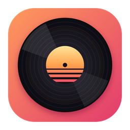

# MySpotify

Windows 和 macOS 上的 Spotify 播放器：Go 写的原生界面，免费账号也能整首播放，还能看 MV。

    

**[下载最新版](https://github.com/margbug01/MySpotify/releases/latest)** · Windows 解压就能用，macOS 拖进「应用程序」，不用安装

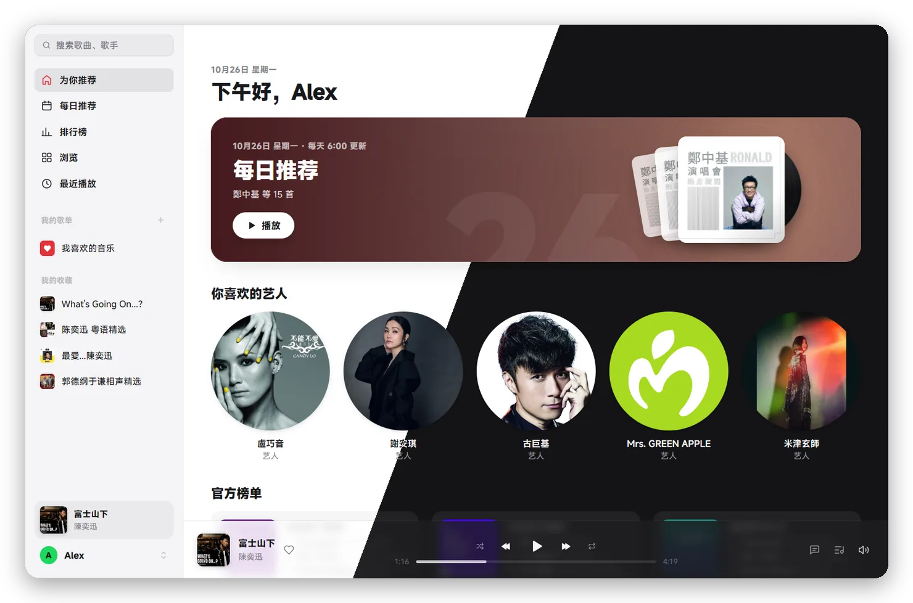

</div>

> [!IMPORTANT]
> MySpotify 是个人项目，和 Spotify 没有任何关系，也没有得到它的认可。它用的是 Spotify 网页播放器自己的内部接口，不是公开 API，Spotify 随时可能改掉；这样用 Spotify 很可能不符合它的用户条款，账号有被限制的风险。只用你自己的账号，后果自负。详见下面的[「风险和边界」](#风险和边界)。

## 为什么用它

**像个桌面软件。** 界面是 [MyGo](https://github.com/egoist/mygo) 画的原生界面，不是套一层网页：侧栏、播放栏、全屏播放页、逐行滚动的歌词、律动舞台、系统媒体键、浅色和深色主题都有。关窗口收进托盘接着放，托盘图标跟着任务栏的深浅色变。只浏览时整个程序约 190MB，放歌时多一个约 60MB 的解密进程。

**不登录也能逛。** 第一次打开不用登录就能搜索、看首页、歌单、专辑和艺人页：MySpotify 像网页播放器一样自己取一个访客身份，不用打开网页，冷启动一两秒就有内容。要听歌再登录。

**免费账号整首放。** 登录走 Spotify 官方的登录页，MySpotify 只是借用网页播放器拿到的身份。音频由系统网页组件自带的 DRM 模块解密，和你在浏览器里听是同一条路，128k AAC：Windows 上是 WebView2 的 Widevine（同 Edge、Chrome），macOS 上是 WebKit 的 FairPlay（同 Safari）。

**能看 MV。** 有 MV 的歌在列表里带个「MV」小标，点它就放 MV，播放栏和播放页也能随时切换。MV 可以放在封面的位置、铺满窗口或者全屏；铺满时控制栏浮在画面上，鼠标停 3 秒就隐藏，旁边是待播清单，下方显示当前这句歌词。MV 往往比原曲多一段开头，歌词会自动往后挪；不准的话按 `[` / `]` 每次调 0.5 秒，按歌记住。

**Spotify 有的大部分都在。** 首页（照 Spotify 的分区和标题，音乐/播客筛选）、每日推荐、排行榜、浏览全部分类、歌单和专辑、艺人页、单曲页（制作人员、播放次数、相似歌曲）、个人主页、播客、搜索（歌曲、艺人、专辑、歌单、播客）、喜欢、关注、收藏、自建歌单的增删改、下一首播放和待播清单、从歌曲或艺人开电台、最近播放。网页或手机上新加的歌单会自己同步过来。

**歌词基本都有，而且会滚。** Spotify 自己没有的，去网易云和 LRCLIB 找，带时间轴的优先，按歌名和时长核对版本，不乱配。当前这首的歌词到手后，顺手把下一首的也取好，切歌一开始就有。

**手机和电脑能接力（实验性）。** 登录后电脑会出现在手机 Spotify 的设备列表里，叫「MySpotify · 电脑名」，点它就转到电脑上放，待播清单和手机上看到的一样。手机在放的时候，电脑这边也能看到、能遥控。

**出错不会卡死。** 许可证过期就自动换身份重试；被 Spotify 限流时播放栏会写「Spotify 暂时限流，稍后重试」，按它要求的时间等完再从原位置接着放；网络或解码出错会先在页面里重试两次；一首歌放到最后卡住不动，也会接着放下一首。Spotify 更新网页播放器、旧的查询失效时，MySpotify 会自己去线上脚本里找新的。

**听过的不用再下。** 放过的歌（加密分段，原样存下）留在本机，再放更快、不耗流量；上限可以在设置里选，也能一键清除。

**数据只在本机。** 设置、播放进度、本机播放记录在 `%APPDATA%\Vinyl`（macOS：`~/Library/Application Support/Vinyl`），登录态在 `%LOCALAPPDATA%\Vinyl\WebView2`（macOS：`~/Library/WebKit/dev.margbug.vinyl`）；续期用的 cookies 另存一份在 `%APPDATA%\Vinyl\account-cookies`（macOS 在同目录，只本人可读）。文件夹叫 Vinyl 是这个项目原来的名字，改名时没动，免得大家被登出。除了 Spotify、Gravatar（取账号邮箱的头像），以及查歌词时的网易云和 LRCLIB（只收到歌名、歌手、专辑和时长），MySpotify 不连别的服务器，也没有统计和自动更新。

## 截图

<table>
  <tr>
    <td width="50%">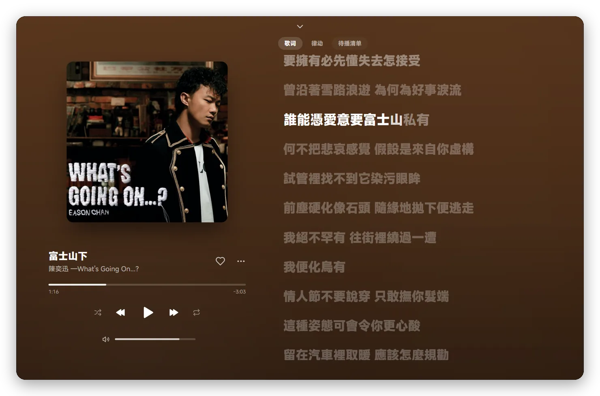</td>
    <td width="50%">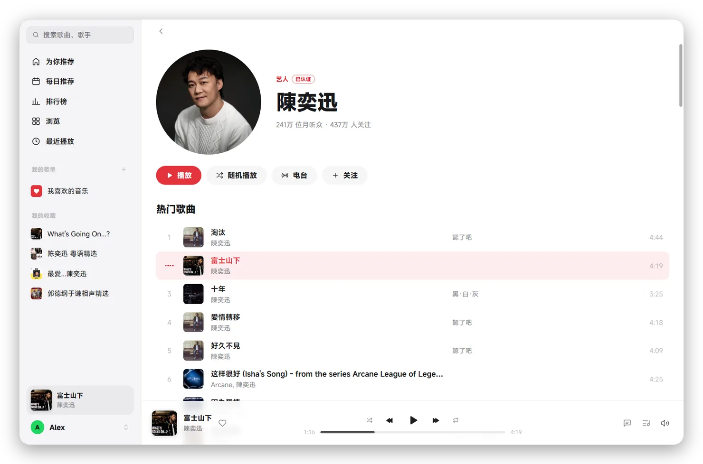</td>
  </tr>
  <tr>
    <td>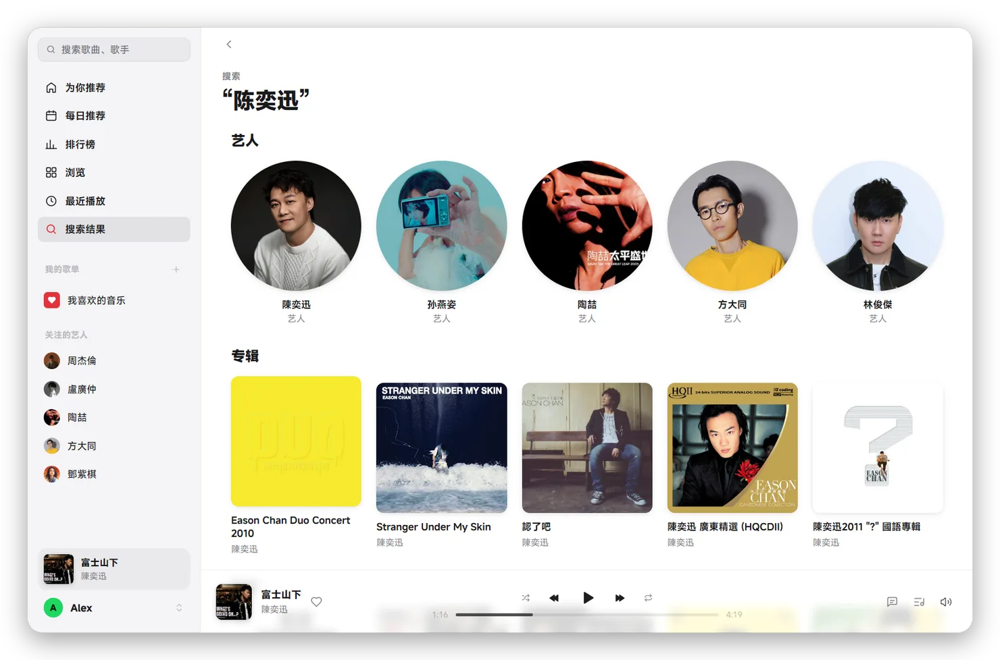</td>
    <td>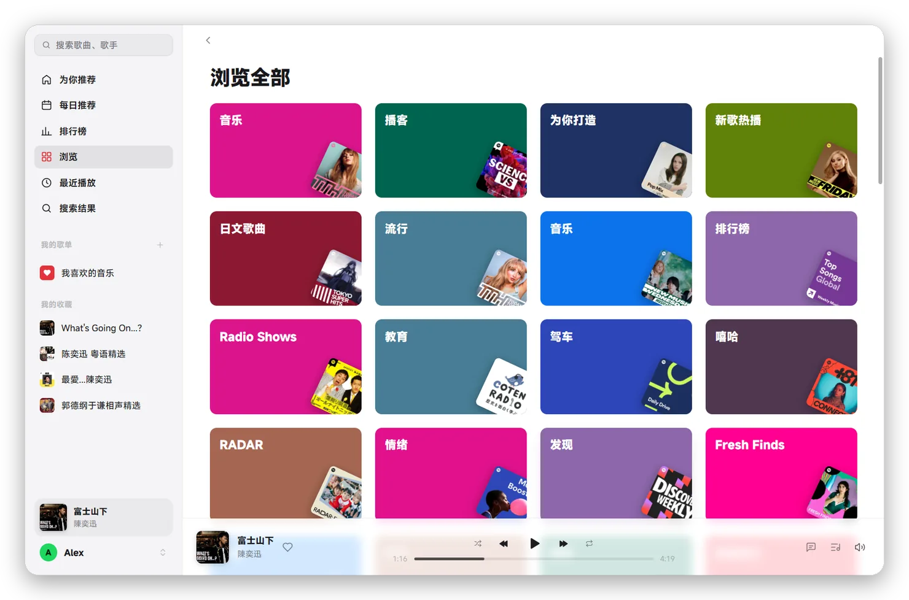</td>
  </tr>
  <tr>
    <td>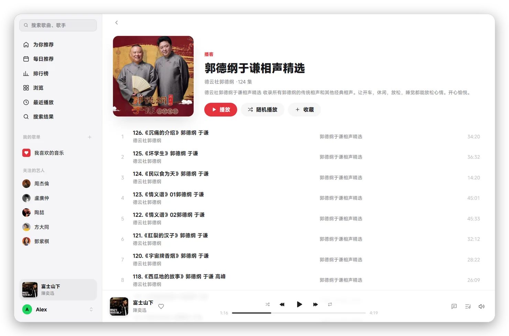</td>
    <td>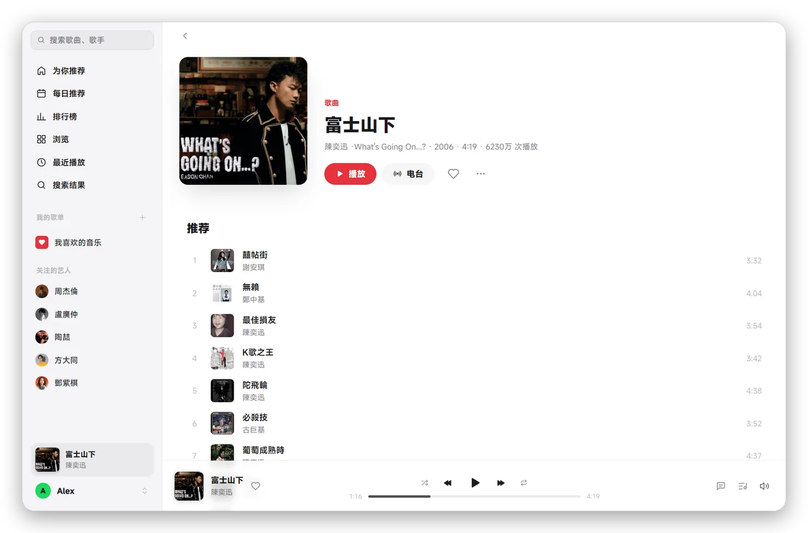</td>
  </tr>
</table>

<details>
<summary>更多截图</summary>

<table>
  <tr>
    <td width="50%">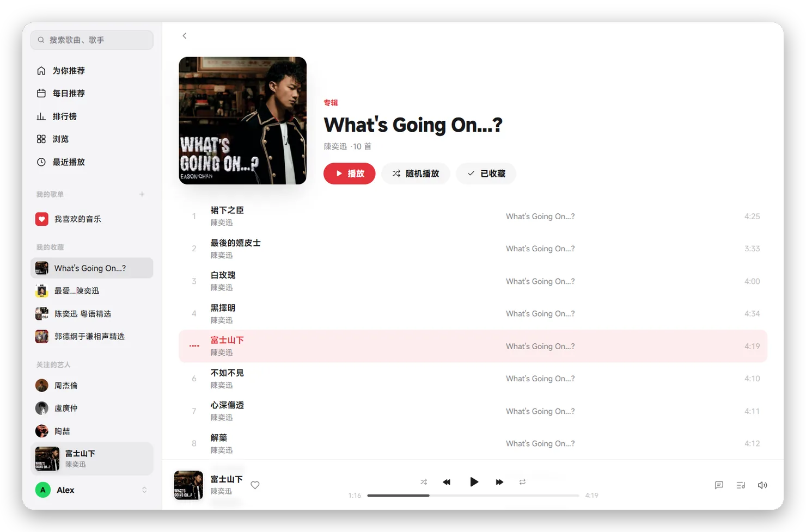</td>
    <td width="50%">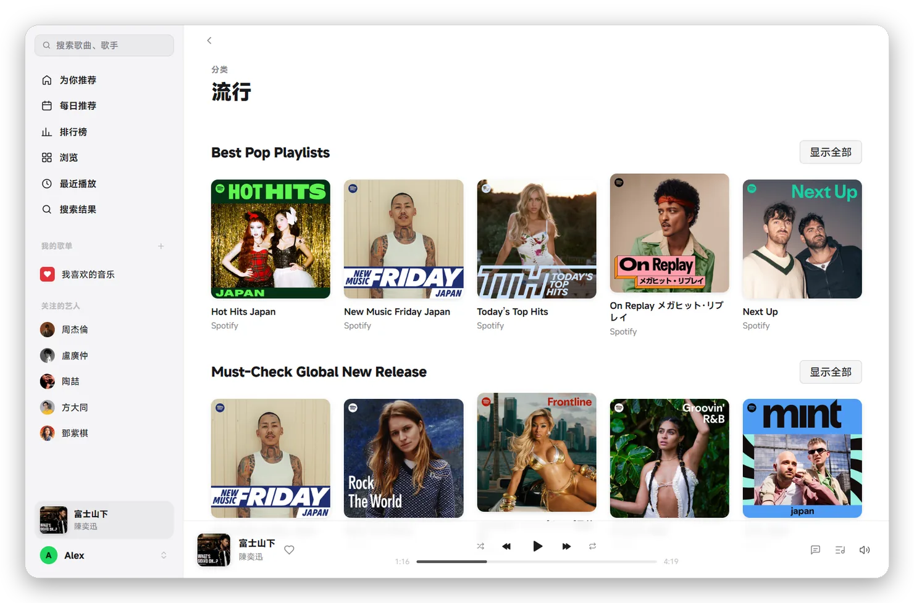</td>
  </tr>
  <tr>
    <td>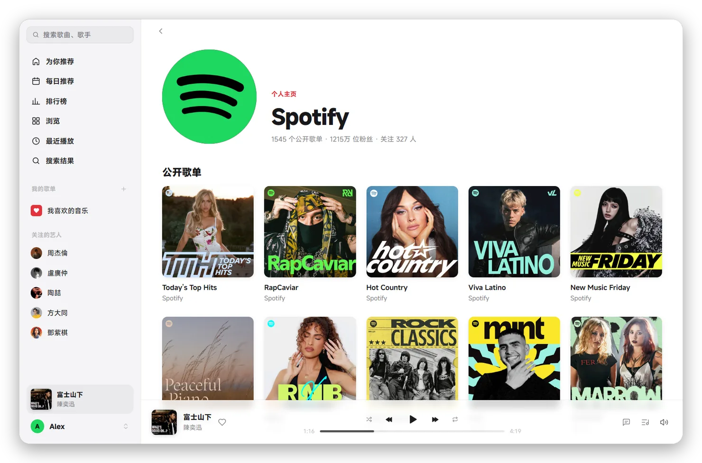</td>
    <td></td>
  </tr>
</table>

</details>

## 开始使用

**Windows**

1. 到 [Releases](https://github.com/margbug01/MySpotify/releases/latest) 下载 `MySpotify-<版本>-windows-amd64.zip`，解压到任意文件夹，双击 `MySpotify.exe`。
2. exe 没有代码签名，第一次打开 Windows 可能弹「Windows 已保护你的电脑」：点「更多信息 › 仍要运行」。不放心可以对一下 Release 里写的 sha256，或者按下面「从源码构建」自己编。
3. 需要 Windows 10 或 11，以及 [WebView2 运行时](https://developer.microsoft.com/microsoft-edge/webview2/)（Windows 11 自带，Windows 10 大多也已经装了）。

升级：右键托盘图标 › 退出 MySpotify，用新的 `MySpotify.exe` 覆盖旧的再打开。设置和登录都不在 exe 旁边，不会丢。

**macOS**（Apple 芯片）

1. 下载 `MySpotify-<版本>-macos-arm64.dmg`，打开后把 MySpotify 拖进「应用程序」。
2. app 没有经过 Apple 公证，第一次打开会被拦下：到「系统设置 › 隐私与安全性」最下面点「仍要打开」。也可以在终端里执行 `xattr -dr com.apple.quarantine /Applications/MySpotify.app` 再打开。
3. 升级：退出旧版，用新的覆盖「应用程序」里的旧版。设置和登录不在 app 里，不会丢。

两边都是：点「登录 Spotify」，在弹出的 Spotify 官方登录页里登录。登录态会留在本机，下次打开不用再登。

快捷键：空格 播放/暂停，Ctrl+← / Ctrl+→ 上一首/下一首，Ctrl+D 喜欢正在放的歌，Ctrl+L 打开播放页，Ctrl+F 搜索，Ctrl+N 新建歌单，Ctrl+, 设置，鼠标侧键前进后退（macOS 上 Ctrl 换成 ⌘）。看 MV 时：F 全屏，Esc 一级级退回，`[` / `]` 让歌词提前、延后 0.5 秒。

## 手机和电脑接力（实验性）

- **转到电脑放**：手机或网页 Spotify 的设备列表里选「MySpotify · 电脑名」。电脑的待播清单和手机上看到的是同一份，点其中一首会在原来的歌单里跳过去（这一步偶尔会被 Spotify 拒绝，见下）。
- **在电脑上管手机**：底部音量旁的「设备」能看到同账号在线的手机、网页和本机。别的设备在放时，电脑显示它的歌和进度，播放/暂停、上一首/下一首、拖进度、音量、随机/循环都发给那台设备。
- 同一时间只有一台设备出声。播放被转走、或者连接断了，电脑这边会停下，不会两边一起响。

这一块还在实验：免费账号的注册和接力实测能用，长时间挂着、各种设备组合还没测全。偶尔会提示「Spotify 没有接受这个操作」，Spotify 给的原因会写进日志 `vinyl.log`（在上面说的设置文件夹里，搜 `connect:`），遇到了欢迎把那一行贴到 issue 里。

## 风险和边界

- **不是官方客户端。** 数据走网页播放器的 Pathfinder GraphQL 和 spclient 接口，这些都没有公开文档，Spotify 改了 MySpotify 就会坏。
- **访客身份。** 不登录时，MySpotify 用和网页播放器相同的办法取一个匿名身份，只看 Spotify 对所有人公开的内容；听歌仍然要登录自己的账号。
- **条款。** Spotify 的用户条款不允许用第三方程序访问它的服务。用 MySpotify 可能导致账号被限制或封禁。只用你自己的账号，别拿它做任何商业用途。
- **广告。** 网页播放器的免费版会插广告，MySpotify 不放。这一点 Spotify 很可能不喜欢；如果你在意，请用官方客户端或订阅 Premium。
- **歌词来源。** 补歌词用的网易云接口没有公开文档，频繁搜索会被它限流，哪天也可能改掉；它和 LRCLIB 都只收到歌名、歌手、专辑和时长。
- **别频繁起播。** 许可证接口按设备限流，短时间里反复起播（比如半小时十几次）会被 429 一阵子。

## 做不了的

| 功能 | 为什么 |
| --- | --- |
| 256k / 无损音质 | 免费号申请 256k 的许可证会被拒（403）；无损只在官方桌面和手机 App 里 |
| 逐字歌词 | Spotify 只给网页播放器逐行时间；网易云的逐字歌词还没接 |
| 离线下载 | 需要 Premium，而且要官方客户端 |
| Jam、DJ | 需要 Premium 或手机端 |
| 视频播客 | 只能放音频（MV 能看） |
| 频谱 | 音频在解密模块里，拿不到；播放中的小音柱是按位置算的动画 |
| Intel Mac、Linux | 只打了 Apple 芯片 Mac 的包；Linux 没做 |
| MV 和歌词精确对齐 | Spotify 不给 MV 和原曲之间差多少，只能按时长估，偏了用 `[` / `]` 手动调 |
| 好友动态、本地文件、Blend | 暂时没做 |

## 常见问题

<details>
<summary>为什么点了播放显示「这首歌暂时无法播放」？</summary>

这首歌在你所在地区不可播，或者 Spotify 拒绝了许可证（403）。同一首在网页版也放不了的话，就是版权问题。日志 `vinyl.log`（Windows 在 `%APPDATA%\Vinyl`，macOS 在 `~/Library/Application Support/Vinyl`）里可以看到具体原因。
</details>

<details>
<summary>播放栏写「Spotify 暂时限流，稍后重试」怎么办？</summary>

什么都不用做。MySpotify 会按 Spotify 要求的时间等完，再从刚才的位置接着放。限流对象是 MySpotify 这个设备，浏览器里的网页版不受影响。
</details>

<details>
<summary>这首歌怎么没有歌词，或者歌词不会滚？</summary>

Spotify、网易云、LRCLIB 三家都没有，或者只有不带时间轴的纯文本（静态显示，不会滚、不能点歌词跳进度）。翻唱、现场版要时长对得上才会用，宁可不显示也不套别的版本。歌词站忙的时候会隔 3 秒、10 秒各再查一次，查歌词时显示的是加载中的灰条。
</details>

<details>
<summary>「每日推荐」是空的？</summary>

新账号要听一阵，Spotify 才会生成 Daily Mix，在那之前这一页没有内容。
</details>

<details>
<summary>为什么还要联网，缓存了不是可以离线吗？</summary>

缓存的是加密的音频，解密要用 Spotify 当场发的许可证。缓存省的是流量和缓冲时间。
</details>

<details>
<summary>代理怎么设？</summary>

MySpotify 用系统代理：Windows 在「设置 › 网络和 Internet › 代理」，macOS 在「系统设置 › 网络 › 详细信息 › 代理」。环境变量 `HTTPS_PROXY` 优先。
</details>

<details>
<summary>macOS 上截图、录屏，MV 画面怎么是黑的？</summary>

MV 是 FairPlay 加密的，macOS 不让任何截图、录屏软件拿到加密视频的画面，Safari 里看 Apple TV+ 也一样。界面、歌词照常能截。
</details>

<details>
<summary>怎么退出登录或者换账号？</summary>

左下角头像 › 退出登录，会清掉 WebView 里的 Spotify 登录态。
</details>

<details>
<summary>关掉窗口怎么还在放歌？怎么真正退出？</summary>

关窗口只是收进托盘，音乐照常放，点托盘图标或者再打开一次 MySpotify 就回来。要退出：右键托盘图标 › 退出 MySpotify。
</details>

## 怎么做到的

- **登录**：一个平时隐藏的窗口打开 open.spotify.com，`internal/spotify/capture.js` 记下网页播放器自己拿到的 token 和 client-token；没登录就把这个窗口显示成 Spotify 的登录页。token 快过期时在后台重新加载一次。
- **数据**：Pathfinder GraphQL 的持久化查询（哈希在 `internal/spotify/spotify.go` 的 `ops` 里）加 spclient（歌词、播放清单、歌单改动、电台、最近播放、个人主页）。公开 Web API 对这个身份一律 429，不用。哈希失效时（412「Invalid query hash」）`internal/spotify/ops.go` 重读主脚本和按需加载的分块脚本，换上新哈希重试一次，存到 `%APPDATA%\Vinyl\queries.json`，10 分钟内不重复读。收藏列表在切回窗口时（5 秒内不重复）和每 30 秒检查一次，网络失败时保留上次的。
- **播放**：另一个隐藏的 WebView 页面（`internal/player/web/player.html`）播加密的 MP4。Windows 用 hls.js + Widevine；macOS 照 Safari 版网页播放器，要 cbcs 格式的文件，用 WebKit 原生 HLS + FairPlay（`skd://` 加文件 ID，`fairplay-license/v1`）。清单、分段和许可证请求都经本机 127.0.0.1 的小服务转发，分段在这里顺手存进缓存，键是 CDN 路径加字节范围（CDN 的签名每天变，不进键）。播客的单集和歌曲走同一条路。这个页面第一次真放歌时才建，闲置 5 分钟就关掉，下次放再从原位置接上；它不用 GPU，主界面照常用 GPU。
- **出错**：许可证 401 换身份再要一次；429 按 Retry-After 等（没给就从 30 秒起翻倍），等完从原位置重来；403 停在这首。页面里的网络错误（`startLoad`，清单出错就重新 `loadSource`）和媒体错误（`recoverMediaError`）每首各重试 2 次，不行再跳下一首。结束事件没送到时，音频停在最后 0.25 秒、尾部已缓冲完、连续约 4 秒不动，才算播完。
- **歌词**：Spotify 的同步歌词 → 网易云（`/api/cloudsearch/pc` 按歌名和主艺人搜，取同名、时长差不超过 2 秒里最接近的一首，它的时长和 Spotify 基本精确到毫秒；文字是简体）→ LRCLIB 精确查询（歌名、主艺人、专辑、时长都要对上）→ LRCLIB 搜索同名同歌手、时长差 2 秒内带时间轴的那条 → 都没有时间轴才用纯文本。Connect 给的歌手名缺失或是外文拼写（Yitai Wang）时，先换成 Spotify 给的中文名（王以太）再查。站点忙或限流（LRCLIB 503、网易云 405/406）时隔 3 秒、10 秒各再试一次，播客不查。
- **Connect**：协议结构参考 [Flutify](https://github.com/is-hp-is-mad/Flutify)，不用 Premium 才能用的 Web Playback SDK。两条 Dealer 长连接：`connect-state` 用一个隐藏的观察者设备看和遥控，`track-playback` 把本机注册成能放歌的设备并处理状态机。状态机只带当前和下一首，所以待播清单按 connect-state 的 `next_tracks` 显示（隐藏的循环副本不显示，只有 URI 的曲目用 `decorateContextTracks` 补上名字）；点其中一首发 `skip_next` 带那首的 uid。本机插队和电台续队还没接进 Connect。
- **MV**：`track-playback/v1/media` 多要一种 `manifest_ids_video`，返回里的 `video_version_uri` 就是这首的 MV。视频清单转成 HLS，在主窗口里一个看得见的 WebView 里放（Windows Widevine、macOS FairPlay），改放 MV 自带的音轨。原生控件盖在视频上：一层透明的框接鼠标，控制栏和字幕都画在 WebView 上面。歌单、专辑、艺人页、喜欢的歌的数据里本来就有 `associationsV3.videoAssociations`，列表的「MV」小标靠它，不用多发请求。
- **头像**：账号的头像依次用 Spotify 上设的、账号邮箱在 Gravatar 上的、名字首字母（底色用 Spotify 给的颜色）。邮箱是带着 WebView 的 cookie 问 `www.spotify.com/api/account-settings/v1/profile` 拿的。

## 从源码构建

需要 Go 1.27.3 以上，不需要 cgo。

```
go test ./...
CGO_ENABLED=0 go build -trimpath -ldflags="-H windowsgui -s -w" -o outputs/MySpotify.exe .
```

macOS 的 app 和 dmg 用 MyGo 自带的打包命令（在 Mac 上跑，产物在 `build/darwin-arm64/`，加 `-skip-dmg` 只出 app）：

```
go tool mygo build
```

图标都由 `tools/icons.py` 画（Windows，要 Pillow，用 Edge 无头模式渲染 SVG）：`resources/icon.svg`/`icon.png` 是程序图标，`icon-small.svg` 是 16–24 像素用的简化版（两道纹、更粗），`icon.ico` 把两者按尺寸合在一起；`internal/app/tray.png` 是托盘和 Mac 菜单栏的模板图标（只有黑色和透明，Windows 深色任务栏上自动画成白色，macOS 自己染色）；`AppIcon.icon` 是 Mac Dock 用的 Icon Composer 文档（浅色/深色两种底，`mygo.json` 的 `macos.icon`，要在装了 Xcode 26 的 Mac 上 `mygo build` 才会编进去，否则退回 `icon.png` 生成的 `.icns`）。改了图标或版本号，先跑 `python tools/icons.py`，再重新生成图标、版本信息和 manifest 所在的 `rsrc_windows_amd64.syso`（版本号同时改 `mygo.json`）：

```
go run github.com/tc-hib/go-winres@v0.3.3 simply --icon resources/icon.ico --manifest gui --product-name MySpotify --file-description MySpotify --product-version 0.3.0 --file-version 0.3.0 --original-filename MySpotify.exe --arch amd64 --out rsrc
```

日志（含崩溃时的堆栈）写在设置文件夹里的 `vinyl.log`，超过 1MB 挪成 `vinyl.log.1` 重新开始。

### 调试

- `NM_SHOTS=<目录>`：走一遍首页、排行榜、歌单、播放页、待播清单、搜索，每步截图（静音）。
- `NM_SHOTS=<目录> NM_SCENE=once`：静音放排行榜里的一首歌 10 秒（`NM_PLAY=<歌单/专辑/播客 URI>` 换成放那张列表的第一首），只要一次许可证，打印播放状态和缓存大小。验证真播放先用它。
- `NM_SHOTS=<目录> NM_SCENE=play`：完整验证播放（起播、拖到结尾接下一首、暂停继续、下一首），要好几次许可证，别连着跑。
- `NM_SHOTS=<目录> NM_SCENE=readme`：用真数据截 README 里的这些图，账号名显示成 Alex（首页标题里的也换），不播放；再跑 `python tools/readme_shots.py <目录> docs/screenshots` 出圆角投影的 WebP。这个场景退出时会写设置和播放会话，想不碰自己的就把 `APPDATA` 指到别的目录再跑。
- `NM_SHOTS=<目录> NM_SCENE=connect`：Connect 注册探针，不放音频，结束后注销测试设备。
- `NM_SHOTS=<目录> NM_SCENE=identity`：把当前登录身份导出成 `identity.json`，给下面的 LIVE 测试用。
- `LIVE=<identity.json> go test -run TestLive ./internal/spotify`：用真身份把每个接口打一遍，只读。
- `LIVE=<identity.json> LIVE_EDIT=1 go test -run TestLiveEdit ./internal/spotify`：在这个账号上建歌单、加歌、删歌、改名、删歌单，收藏专辑/歌单/播客、点喜欢、关注艺人，每步读回来核对，最后全部恢复原样。会真改账号。
- `LIVE=1 go test -run TestLiveScriptHashes ./internal/spotify`：检查现在用的查询哈希是否都还能在线上脚本里找到。

不带 `-H windowsgui` 编出来的版本能在控制台看到这些场景的输出。

## 致谢

- 界面来自 [egoist/mygo-cloudmusic](https://github.com/egoist/mygo-cloudmusic)（一个网易云音乐客户端），数据和播放换成了 Spotify。仓库保留了上游历史，可以 `git merge upstream/main` 拉作者的界面更新。
- [MyGo](https://github.com/egoist/mygo)：Go 的原生界面框架。
- [hls.js](https://github.com/video-dev/hls.js)（Apache-2.0），在 `internal/player/web/hls.min.js`。
- [Flutify](https://github.com/is-hp-is-mad/Flutify)：Connect 协议结构的参考。
- 歌词来自 [LRCLIB](https://lrclib.net/) 和网易云音乐。

## 许可证

[AGPL-3.0](LICENSE)，随上游。Release 压缩包里的 `licenses/` 是编进 exe 的第三方代码的许可证。图标是 MySpotify 自己画的（`tools/icons.py`，「转动的唱片」：一张黑胶，三道纹路接住光）。Spotify 是 Spotify AB 的商标，名字里的 Spotify 只是说明它播放的是什么，截图里的封面和照片版权归各自的权利人。
