<div align="center">

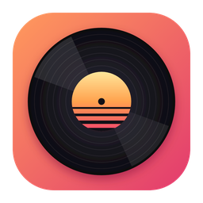

# MySpotify

**把 Spotify 放進真正的桌面軟體**

原生介面、會捲動的歌詞、MV 和影片 Podcast。免費帳號也能完整播放，不登入也能先逛逛。

[English](README.md) · [简体中文](README.zh-CN.md) · **繁體中文** · [日本語](README.ja.md) · [Italiano](README.it.md)

[](https://github.com/margbug01/MySpotify/actions/workflows/test.yml) [](https://github.com/margbug01/MySpotify/releases/latest)   

**[下載最新版](https://github.com/margbug01/MySpotify/releases/latest)** · [官網](https://margbug01.github.io/MySpotify/) · [安裝步驟](#開始使用) · [常見問題](#常見問題)

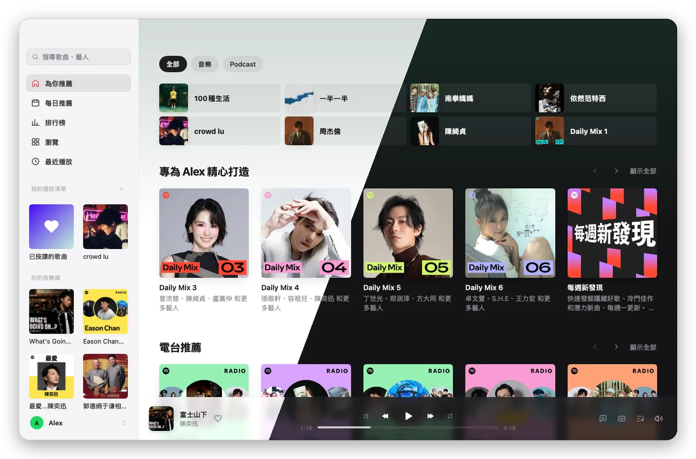

</div>

Linux 提供實驗性的 `.deb` / `.tar.gz` 版本。amd64 預設使用 Qt WebEngine 後端，已在 WSLg 驗證既有登入的遷移、重新啟動後的續期，以及 75 秒的實際音樂播放；登入與播放共用同一個引擎，不需要啟動 Chrome 瀏覽器。需要另外安裝 Qt 執行環境和官方 Chrome 的 Widevine 元件，目前還不算穩定支援的平台。安裝方法、記憶體實測和限制請見 [Linux 發行說明](LINUX.md#qt-webengine-后端2026-11-10)（簡體中文）。

> [!IMPORTANT]
> MySpotify 是個人專案，和 Spotify 沒有任何關係，也沒有得到它的認可。它使用的是 Spotify 網頁播放器自己的內部介面，不是公開 API，Spotify 隨時可能變更；這樣使用 Spotify 很可能不符合它的使用條款，帳號有被限制的風險。請只用你自己的帳號，後果自負。詳見[「風險和界線」](#風險和界線)。

## 為什麼用它

| | |
| --- | --- |
| **像個桌面軟體** | 介面由 [MyGo](https://github.com/egoist/mygo) 原生繪製，不是套一層網頁：側邊欄、播放列、全螢幕播放頁、律動舞台、系統媒體鍵、全域快速鍵、淺色和深色主題都有。關閉視窗後會收進系統匣繼續播放。只瀏覽時整個程式約使用 190MB，播放時多一個約 60MB 的解密程序。 |
| **不登入也能逛** | 一打開就能搜尋，看首頁、播放清單、專輯和藝人頁：MySpotify 和網頁播放器一樣，會自己取得一個訪客身分，冷啟動一兩秒就有內容。想聽歌時再登入。 |
| **免費帳號完整播放** | 登入走 Spotify 官方的登入頁。音訊由系統網頁元件內建的 DRM 模組解密，和你在瀏覽器裡聽是同一條路，128k AAC：Windows 上是 WebView2 的 Widevine，macOS 上是 WebKit 的 FairPlay。 |
| **歌詞幾乎都有，而且會捲動** | Spotify 沒有的，會去網易雲音樂和 LRCLIB 找，優先使用有時間軸的歌詞，並核對歌名和長度，不會配錯版本。外語歌有中文翻譯時，每行原文下方會顯示一行翻譯。介面語言是繁體中文時，簡體歌詞和翻譯會自動轉成繁體字。在 Mac 和 Windows 上點播放列的「桌面歌詞」，正在唱的那句就會浮在所有視窗上方，唱到的字會跟著封面的顏色亮起；鎖定後滑鼠可以直接穿過。字級、顏色，以及第二行要顯示翻譯還是下一句，都能在「設定 › 桌面歌詞」裡調整。 |
| **能看 MV** | 有 MV 的歌會帶一個「MV」小標籤，點一下就播放，播放列和播放頁也能隨時切換。可以放在封面的位置、填滿視窗或全螢幕，下方顯示目前這句歌詞。歌詞不準時，按 `[` / `]` 每次調整 0.5 秒，每首歌會分別記住。 |
| **Podcast 能聽、能看、能跟讀** | 影片 Podcast 點「影片」就能看畫面。逐字稿會像歌詞一樣捲動，一個詞一個詞亮起，點一句就會跳過去。 |
| **Spotify 有的大部分都在** | 首頁、每日推薦、排行榜、瀏覽所有分類、播放清單和專輯、藝人頁、歌曲頁、個人檔案、搜尋、按讚、追蹤、收藏、自建播放清單的新增刪除與修改、下一首播放和待播清單、電台、最近播放。在網頁或手機上新增的播放清單會自動同步過來。 |
| **手機和電腦接力（實驗性）** | 電腦會出現在手機 Spotify 的裝置清單裡，點一下就轉到電腦上播放；手機在播放時，電腦這邊也能看到並遙控。[詳情](#手機和電腦接力實驗性) |
| **出錯不會卡住** | 授權過期會自動換身分重試；被限制請求頻率時，會等到 Spotify 要求的時間結束，再從原本的位置繼續播放；斷線時會等網路恢復後繼續播放。Spotify 更新網頁播放器、舊的查詢失效時，MySpotify 會自己到線上腳本裡找新的查詢。 |
| **聽過的不用再下載** | 播放過的歌曲（原樣保存的加密區段）會留在本機，再播放時更快、不耗流量；上限可以在設定裡選擇，也能一鍵清除。 |
| **資料只在本機** | 沒有統計和追蹤。只會連線到 Spotify、Gravatar（取得帳號電子郵件的頭像）、查歌詞時的網易雲音樂和 LRCLIB（只會收到歌名、歌手、專輯和長度），以及檢查更新時的 GitHub。[資料存放在哪裡](#設定和登入狀態存放在哪裡) |

## 截圖

<table>
  <tr>
    <td width="50%">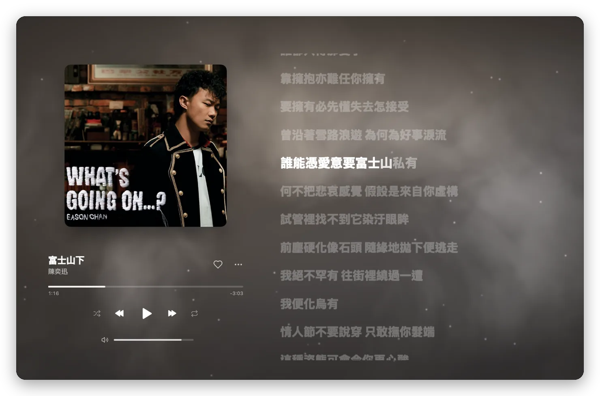</td>
    <td width="50%">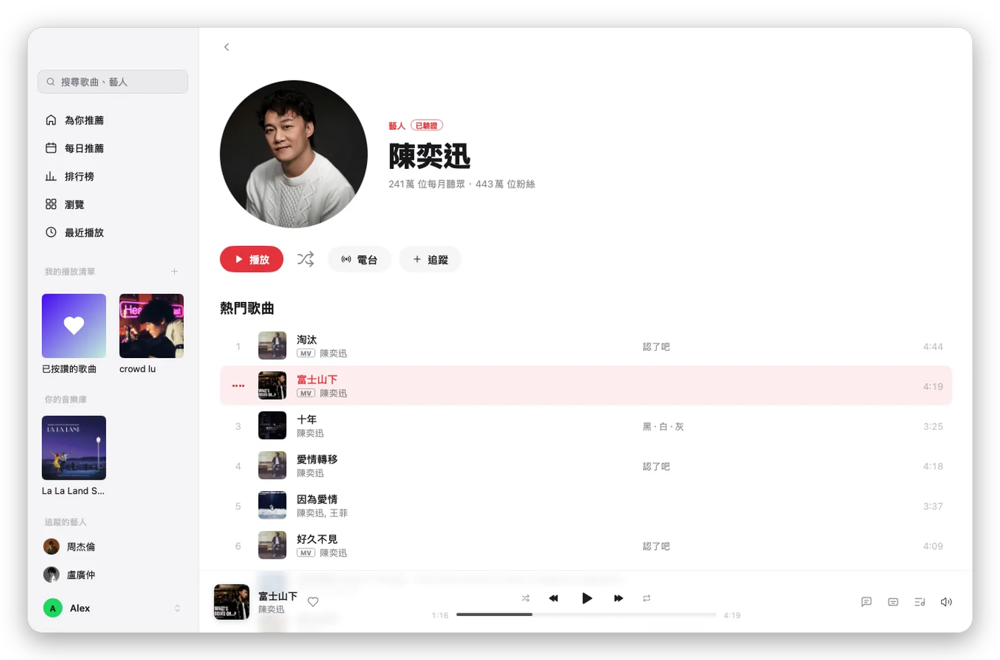</td>
  </tr>
  <tr>
    <td>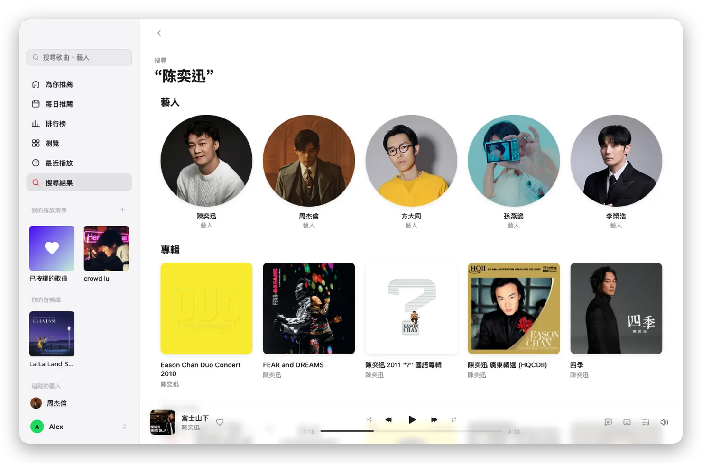</td>
    <td>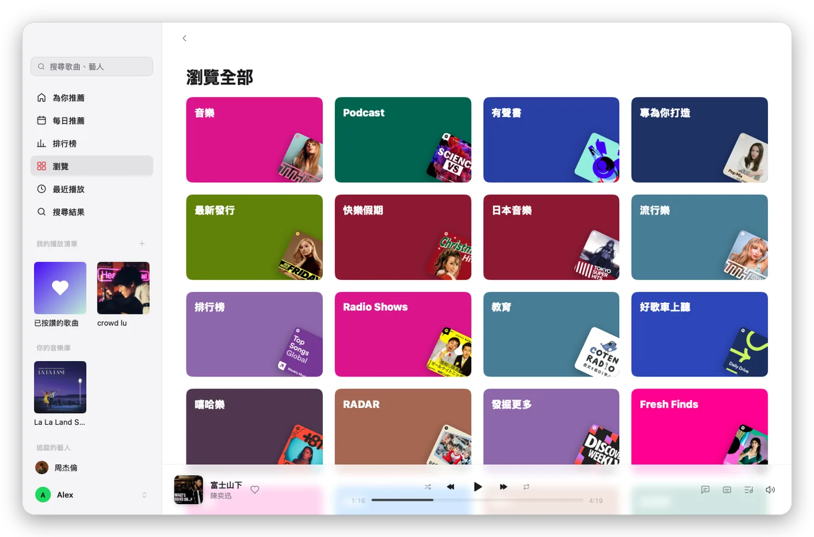</td>
  </tr>
  <tr>
    <td>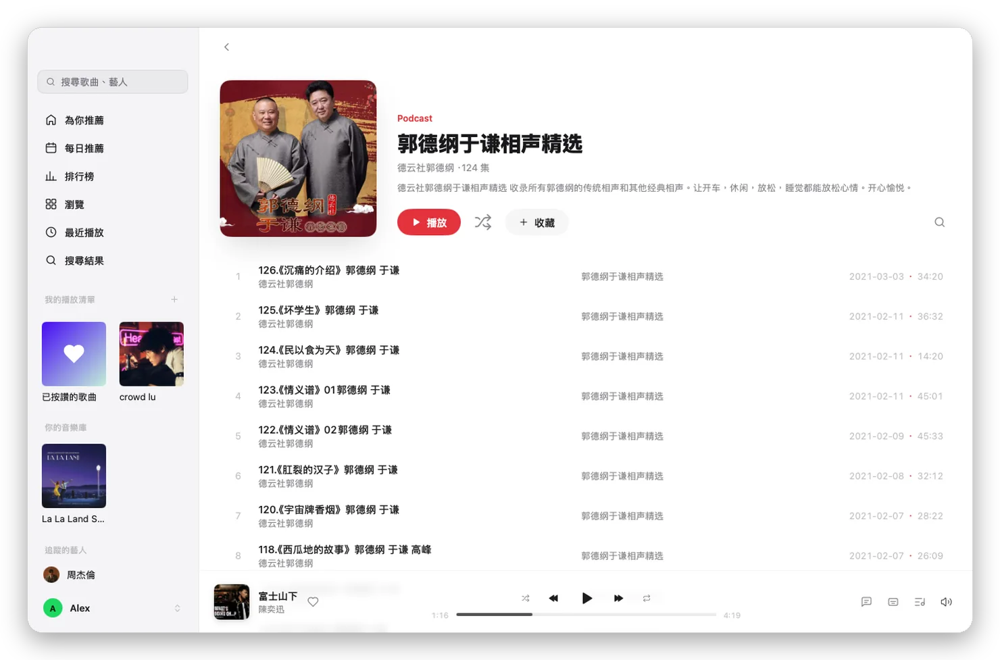</td>
    <td>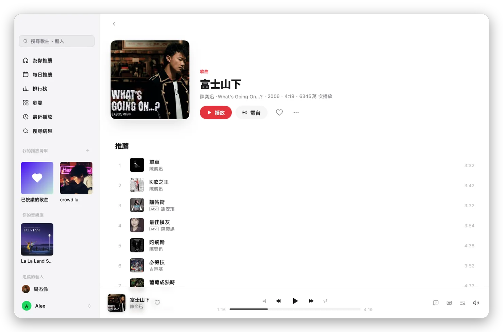</td>
  </tr>
</table>

<details>
<summary>更多截圖</summary>

<table>
  <tr>
    <td width="50%">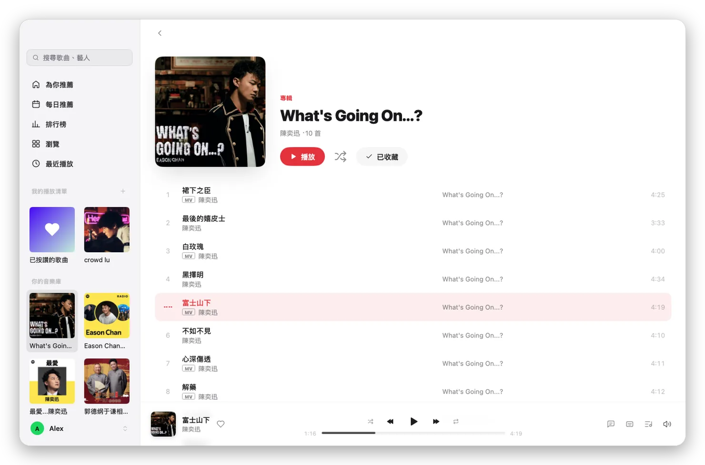</td>
    <td width="50%">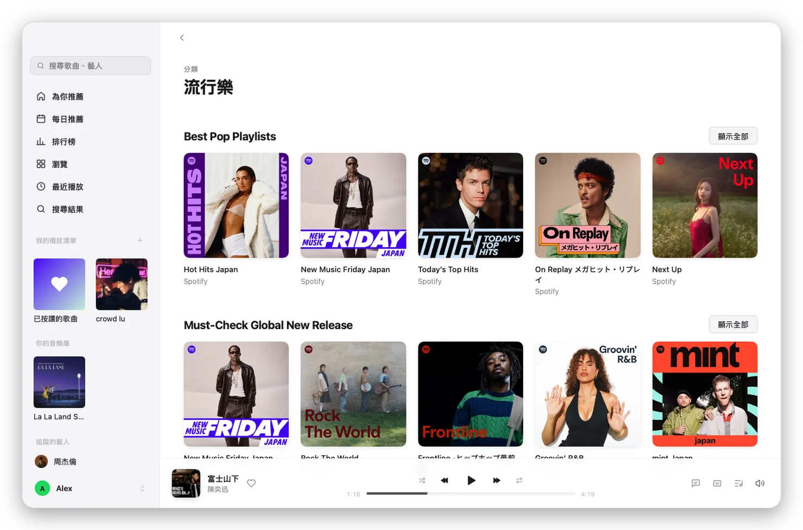</td>
  </tr>
  <tr>
    <td>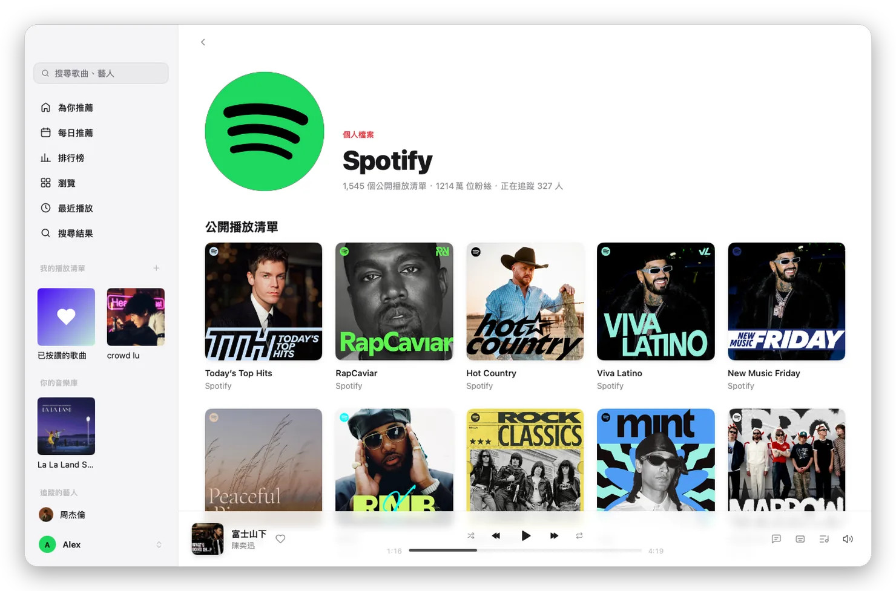</td>
    <td></td>
  </tr>
</table>

</details>

## 開始使用

v0.4.17 起支援簡體中文和英文，v0.4.23 起加入義大利文，v0.4.45 起加入繁體中文和日文：在「設定 › 外觀 › 語言」選擇「跟隨系統」、简体中文、繁體中文、English、Italiano 或日本語，會立即切換並記住選擇。系統語言是繁體中文（台灣、香港、澳門）時，「跟隨系統」會使用繁體中文。歌名、歌手名和歌詞內容維持原樣，只有中文歌詞和中文翻譯會轉成繁體字。

### Windows

1. 到 [Releases](https://github.com/margbug01/MySpotify/releases/latest) 下載 `MySpotify-<版本>-windows-amd64.zip`，解壓縮到任意資料夾，按兩下 `MySpotify.exe`。
2. exe 沒有程式碼簽章，第一次開啟時 Windows 可能會跳出「Windows 已保護您的電腦」：點「其他資訊 › 仍要執行」。不放心的話，可以核對 Release 裡寫的 sha256，或照[開發說明](DEVELOPMENT.md#从源码构建)（簡體中文）自己編譯。
3. 需要 Windows 10 或 11，以及 [WebView2 執行階段](https://developer.microsoft.com/microsoft-edge/webview2/)（Windows 11 內建，大多數 Windows 10 也已經裝好）。

更新：0.4.0 起在「設定 › 關於」裡點「更新並重新啟動」即可，有新版本時側邊欄左下角會提示。從 0.3.0 或更早的版本升級，需要手動更新一次：在系統匣圖示上按右鍵 › 結束 MySpotify，用新的檔案覆蓋舊的再開啟。設定和登入狀態都不在 exe 旁邊，不會遺失。

### macOS（Apple 晶片 / Intel）

1. Apple 晶片請下載 `MySpotify-<版本>-macos-arm64.dmg`；Intel 請下載 `MySpotify-<版本>-macos-amd64.dmg`（實驗版）。打開後把 MySpotify 拖進「應用程式」。
2. 這個 app 沒有經過 Apple 公證，第一次開啟會被擋下：到「系統設定 › 隱私權與安全性」最下方點「強制打開」。也可以在終端機執行 `xattr -dr com.apple.quarantine /Applications/MySpotify.app` 再開啟。

Intel 版已通過交叉編譯和安裝包檢查，但還沒在 Intel 實機上驗證登入、音樂 / MV 播放和 app 內更新。遇到問題時，請在 [#15](https://github.com/margbug01/MySpotify/issues/15) 附上 Mac 型號、macOS 版本和錯誤記錄。

更新：0.4.0 起在「設定 › 關於」裡點「更新並重新啟動」（也可以用選單「MySpotify › 檢查更新……」）；app 必須放在可寫入的位置，例如「應用程式」，直接在 dmg 裡開啟的無法自行更新。從 0.3.0 升級需要手動更新一次：結束舊版，用新版覆蓋「應用程式」裡的舊版。設定和登入狀態不在 app 裡，不會遺失。

### 登入

兩個平台都一樣：點「登入 Spotify」，在跳出的 Spotify 官方登入頁登入。登入狀態會保留在本機，下次開啟不用再登入。

### 快速鍵

| 操作 | 按鍵（macOS 上把 Ctrl 換成 ⌘） |
| --- | --- |
| 播放 / 暫停 | `空白鍵` |
| 上一首 / 下一首 | `Ctrl+←` / `Ctrl+→` |
| 對正在播放的歌按讚 | `Ctrl+D` |
| 開啟播放頁 | `Ctrl+L` |
| 搜尋 | `Ctrl+F` |
| 建立播放清單 | `Ctrl+N` |
| 設定 | `Ctrl+,` |
| 上一頁 / 下一頁 | 滑鼠側鍵 |
| 看 MV 時全螢幕 / 逐層退出 | `F` / `Esc` |
| 看 MV 時歌詞提前 / 延後 0.5 秒 | `[` / `]` |

在「設定 › 全域快速鍵」裡，還可以分別為播放/暫停、下一首、上一首設定一組按鍵，切換到其他應用程式時也能使用。

### 用 AppleScript 讀取正在播放的內容（macOS）

腳本可以唯讀查詢正在播放什麼，寫法和「音樂」App 差不多：

```applescript
tell application "MySpotify"
	set {state, pos, rate, t} to {player state, player position, player rate, current track}
end tell
if t is not missing value then return name of t & " - " & artist of t & " (" & kind of t & ")"
```

- `player state`：`playing`、`paused`，什麼都沒載入時是 `stopped`
- `player position`：播放進度（秒）；`player rate`：播放速率，Podcast 是選好的倍速，歌曲是 1
- `current track`：一筆記錄，包含 `id`（Spotify URI，例如 `spotify:track:…`）、`name`、`artist`、`album`、`duration`（秒）、`kind`（`song` 或 `episode`）。什麼都沒載入時，它和 `player position` 都是 `missing value`。它是記錄而不是物件，要取單一欄位需寫成 `name of (get current track)`，或像上面那樣先存進變數

第一次從其他應用程式（「工序指令編寫程式」、終端機裡的 `osascript`）查詢時，macOS 會詢問是否允許它控制 MySpotify，選擇允許即可。

## 手機和電腦接力（實驗性）

- **轉到電腦播放**：在手機或網頁版 Spotify 的裝置清單裡選擇「MySpotify · 電腦名稱」。電腦的待播清單和手機上看到的是同一份，點其中一首會在原本的播放清單裡跳過去（這一步偶爾會被 Spotify 拒絕，見下文）。
- **在電腦上控制手機**：底部音量旁邊的「播放裝置」會列出同一帳號在線上的手機、網頁版和這台電腦。其他裝置正在播放時，電腦會顯示它的歌曲和進度，播放/暫停、上一首/下一首、拖曳進度、音量、隨機/重複播放都會送到那台裝置。
- **Google Cast 喇叭**：同一個網路裡的 Google Cast / Nest 喇叭（包括多房間群組）也會列在「播放裝置」裡，即使喇叭上沒開 Spotify 也可以，點一下會先喚醒再轉過去。第一次打開「播放裝置」時，macOS 會詢問能否存取區域網路，請選擇允許。
- 同一時間只有一台裝置會發出聲音。播放被轉走或連線中斷時，電腦這邊會停止，不會兩邊同時播放。

這部分還在實驗中：免費帳號的註冊和接力實測可以用，長時間連線和各種裝置組合還沒測完。偶爾會出現「Spotify 沒有接受這個操作」的提示，Spotify 給的原因會寫進記錄檔 `vinyl.log`（搜尋 `connect:`），遇到時歡迎把那一行貼到 issue 裡。

## 風險和界線

- **不是官方用戶端。** 資料來自網頁播放器的 Pathfinder GraphQL 和 spclient 介面，這些都沒有公開文件，Spotify 一改，MySpotify 就會壞掉。
- **訪客身分。** 沒有登入時，MySpotify 會用和網頁播放器相同的方法取得一個匿名身分，只能看到 Spotify 對所有人公開的內容；聽歌仍然需要登入你自己的帳號。
- **條款。** Spotify 的使用條款不允許用第三方程式存取它的服務。使用 MySpotify 可能導致帳號被限制或停權。請只用你自己的帳號，也不要用於任何商業用途。
- **廣告。** 網頁播放器的免費版會插入廣告，MySpotify 不會播放。Spotify 很可能不喜歡這一點；如果你在意，請使用官方用戶端或訂閱 Premium。
- **不碰金鑰。** MySpotify 不破解 DRM：解密在 WebView2 的 Widevine 或 WebKit 的 FairPlay 模組裡完成，程式拿不到金鑰，也拿不到解密後的音訊和畫面（所以在 macOS 上截圖、錄影時 MV 畫面是黑的）。程式只讀取檔頭裡寫明的加密方式和金鑰編號（key ID），用來在記錄檔裡說明某首歌為什麼無法播放。快取裡存的是 CDN 提供的加密區段，每次播放仍要向 Spotify 申請授權，無法離線播放。
- **歌詞來源。** 補歌詞用的網易雲音樂介面沒有公開文件，頻繁搜尋會被它限制頻率，哪天也可能變更；它和 LRCLIB 都只會收到歌名、歌手、專輯和長度。
- **不要頻繁開始播放。** 授權介面會依裝置限制請求頻率，短時間內反覆開始播放（例如半小時十幾次）會被回應 429 一段時間。

## 做不到的事

| 功能 | 原因 |
| --- | --- |
| 無損音質 | 只有官方桌面版和手機 App 才有。256k 是 Premium 帳號專用：在「設定 › 音質」開啟「高音質（256k）」；免費帳號申請 256k 的授權會被拒絕（403），這首歌會自動改用 128k |
| 逐字歌詞 | Spotify 只提供網頁播放器逐行時間；網易雲音樂的逐字歌詞還沒接上 |
| 離線下載 | 需要 Premium，而且要用官方用戶端 |
| Jam、DJ | 需要 Premium 或手機版 |
| macOS 上的部分 Podcast | 由 Spotify 自行託管、只提供 Widevine 加密音訊的節目，FairPlay 無法解密；影片 Podcast 和有原始音訊網址的節目都能播放 |
| Podcast 逐字稿的中文翻譯 | 逐字稿只有原文和 Spotify 提供的幾種外語翻譯，沒有中文 |
| 頻譜 | 音訊在解密模組裡，取不到；播放時的小音柱是依播放位置計算的動畫 |
| Intel Mac、Linux | 提供實驗性安裝包，還不算穩定支援的平台；Intel 版還需要實機驗證，Linux 請見[安裝說明](LINUX.md)（簡體中文） |
| MV 和歌詞精準對齊 | Spotify 沒有提供 MV 和原曲之間的時間差，只能依長度估算，有偏差時用 `[` / `]` 手動調整 |
| 好友動態、本機檔案、Blend | 暫時還沒做 |

## 常見問題

<details>
<summary>為什麼按了播放會顯示「這首歌曲目前無法播放」？</summary>

這首歌在你所在的地區無法播放，或 Spotify 拒絕了授權（403）。如果同一首歌在網頁版也播不了，就是版權問題。記錄檔 `vinyl.log`（Windows 在 `%APPDATA%\Vinyl`，macOS 在 `~/Library/Application Support/Vinyl`）裡可以看到具體原因。
</details>

<details>
<summary>播放列顯示「Spotify 目前限制請求頻率，請稍後重試」該怎麼辦？</summary>

什麼都不用做。MySpotify 會等到 Spotify 要求的時間結束，再從剛才的位置繼續播放。被限制的是 MySpotify 這個裝置，瀏覽器裡的網頁版不受影響。
</details>

<details>
<summary>這首歌為什麼沒有歌詞，或歌詞不會捲動？</summary>

Spotify、網易雲音樂、LRCLIB 三個來源都沒有，或只有不帶時間軸的純文字（靜態顯示，不會捲動，也不能點歌詞跳到對應進度）。翻唱和現場版要長度吻合才會使用，寧可不顯示也不套用別的版本。歌詞網站忙碌時，會在 3 秒和 10 秒後各再查一次，查詢期間會顯示載入中的灰色長條。
</details>

<details>
<summary>「每日推薦」是空的？</summary>

新帳號要聽一陣子，Spotify 才會產生 Daily Mix，在那之前這一頁不會有內容。
</details>

<details>
<summary>已經快取了，為什麼還要連網？</summary>

快取的是加密的音訊，解密需要 Spotify 當下發的授權。快取省下的是流量和緩衝時間。
</details>

<details>
<summary>代理伺服器怎麼設定？</summary>

預設跟隨系統的代理伺服器：Windows 在「設定 › 網路和網際網路 › Proxy」，macOS 在「系統設定 › 網路 › 詳細資訊 › 代理伺服器」，環境變數 `HTTPS_PROXY` 優先。也可以在 MySpotify 的「設定 › 網路 › 代理伺服器」裡另外填入 `127.0.0.1:7890`、`http://…`、`https://…` 或 `socks5://…`。
</details>

<details>
<summary>在 macOS 上截圖、錄影時，MV 畫面為什麼是黑的？</summary>

MV 使用 FairPlay 加密，macOS 不會讓任何截圖或錄影軟體取得加密影片的畫面，在 Safari 裡看 Apple TV+ 也是一樣。介面和歌詞可以正常截圖。
</details>

<details>
<summary>怎麼登出或切換帳號？</summary>

左下角頭像 › 登出，會清除 WebView 裡的 Spotify 登入狀態。
</details>

<details>
<summary>關閉視窗後為什麼還在播放？要怎麼真正結束？</summary>

關閉視窗只會收進系統匣，音樂會繼續播放，點系統匣圖示或再開啟一次 MySpotify 就會回來。要結束時：在系統匣圖示上按右鍵 › 結束 MySpotify。也可以在「設定」裡開啟「關閉視窗時結束應用程式」。
</details>

### 設定和登入狀態存放在哪裡？

| 內容 | Windows | macOS |
| --- | --- | --- |
| 設定、播放進度、本機播放記錄、記錄檔 | `%APPDATA%\Vinyl` | `~/Library/Application Support/Vinyl` |
| 登入狀態 | `%LOCALAPPDATA%\Vinyl\WebView2` | `~/Library/WebKit/dev.margbug.vinyl` |
| 續期用的 cookies（已加密） | `%LOCALAPPDATA%\Vinyl\account-cookies` | `~/Library/Application Support/Vinyl/account-cookies` |

cookies 會加密保存：Windows 用 DPAPI 綁定目前登入的使用者，macOS 的金鑰放在登入鑰匙圈裡，只複製這個檔案是解不開的；登出或登入失效時會刪除。資料夾叫 Vinyl，是這個專案原本的名字，改名時沒有更動，以免大家被登出。

## 參與開發

實作原理、從原始碼建置、發行和除錯都在 **[開發說明](DEVELOPMENT.md)**（簡體中文）裡。

## 致謝

- 介面來自 [egoist/mygo-cloudmusic](https://github.com/egoist/mygo-cloudmusic)（一個網易雲音樂用戶端），資料和播放換成了 Spotify。儲存庫保留了上游的歷史，可以用 `git merge upstream/main` 拉取作者的介面更新。
- [MyGo](https://github.com/egoist/mygo)：Go 的原生介面框架。
- [hls.js](https://github.com/video-dev/hls.js)（Apache-2.0），在 `internal/player/web/hls.min.js`。
- [Flutify](https://github.com/is-hp-is-mad/Flutify)：Connect 協定結構的參考。
- [OpenCC](https://github.com/BYVoid/OpenCC)（Apache-2.0）：歌詞的簡繁轉換字表和詞表。
- 歌詞來自 [LRCLIB](https://lrclib.net/) 和網易雲音樂。
- 繁體中文介面由 [@LeeMatthewCat](https://github.com/LeeMatthewCat) 翻譯。

## 友站連結

- [LINUX DO](https://linux.do/)：真誠、友善、團結、專業，共建高品質開源與極客社群

## 其他作品

同一位作者的 MyGo 應用程式：[Mami](https://github.com/margbug01/mami) · [MyShoes](https://github.com/margbug01/ShoesGUI) · [Candle](https://github.com/margbug01/Candle)

## 授權條款

[AGPL-3.0](LICENSE)，與上游相同。[`licenses/`](licenses) 收錄了編譯進程式的第三方程式碼的授權條款，會隨程式一起發行（Windows 在 exe 旁邊，macOS 在 app 的 Resources 裡）。圖示是 MySpotify 自己畫的（`tools/icons.py`，「轉動的唱片」：一張黑膠唱片，三道紋路接住光線）。Spotify 是 Spotify AB 的商標，名稱裡的 Spotify 只是說明它播放的內容，截圖裡的封面和照片版權歸各自的權利人所有。
